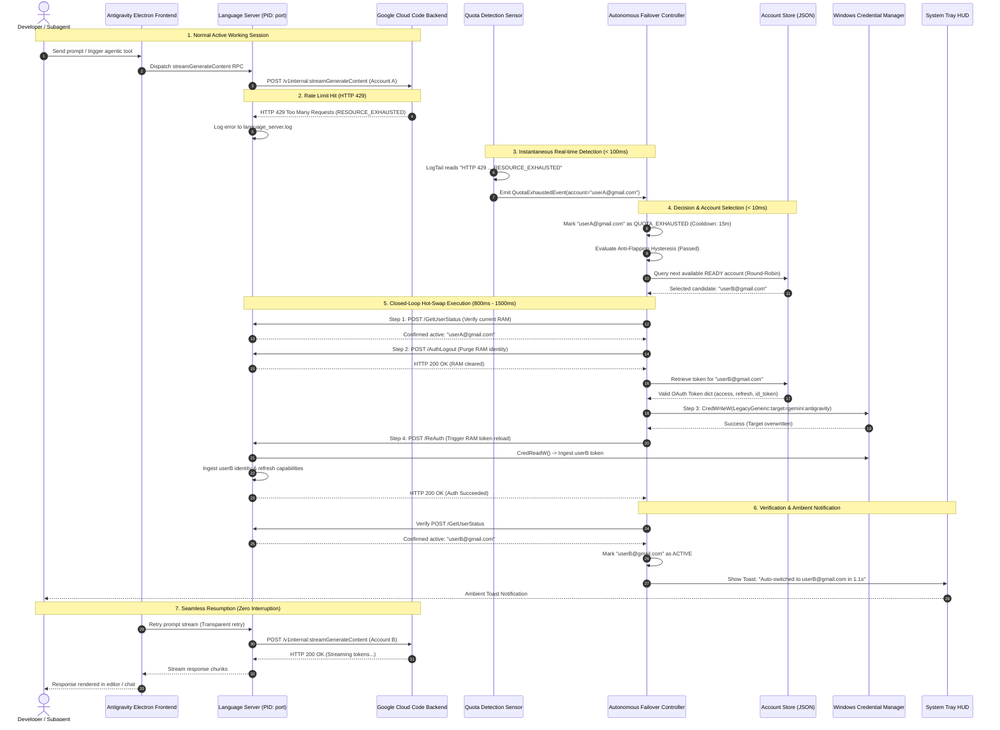
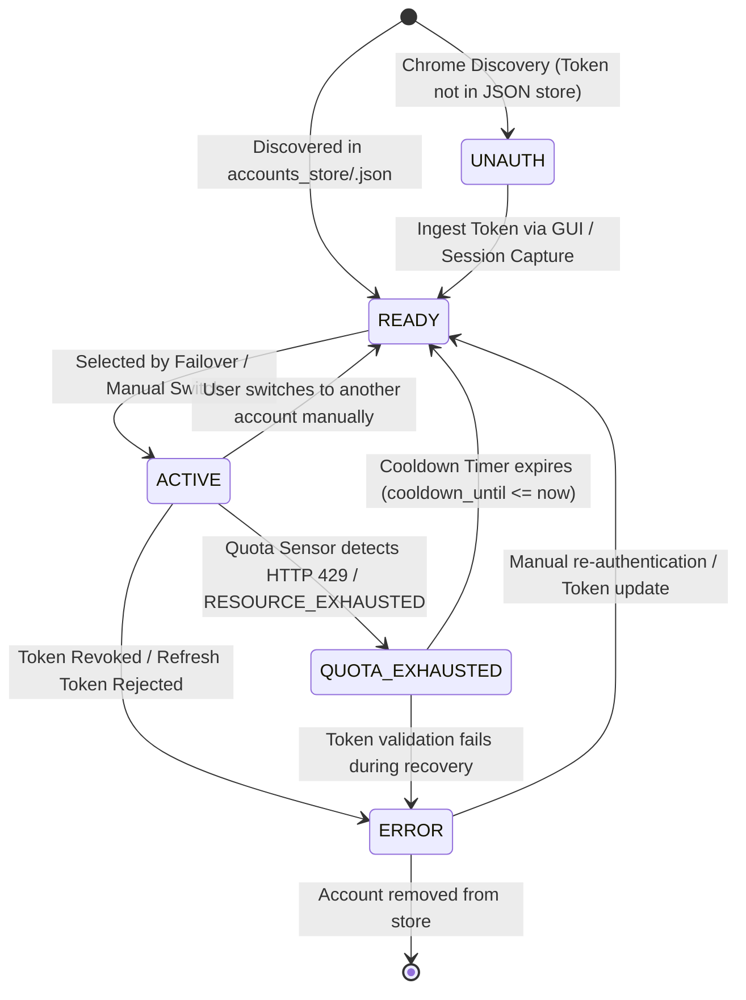
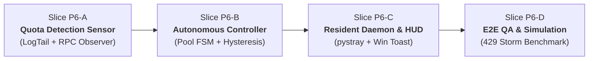

# Architectural Design Report: Smart Quota Monitor & Autonomous Failover Engine (Phase P6)

**Document Reference:** `reports/architect/2026-10-14-autonomous-quota-failover-architecture.md`  
**Date:** 2026-10-14  
**Author:** System Architect  
**Authority:** Owner Directive via CEO Agent (`403f41a7-0810-44d9-b875-1e08c4ed13a0`)  
**Status:** PROPOSED / SPECIFICATION  
**Target Milestone:** Phase P6 (Autonomous Quota Failover Engine)

---

## 1. Executive Summary & Problem Statement

### 1.1 The Problem: Rate Limiting as the Primary Bottleneck in Autonomous AI Pair Programming
Modern AI-assisted software development in Google Antigravity relies heavily on high-throughput, multi-turn reasoning and agentic workflows. In complex engineering sessions—where parent agents orchestrate multiple autonomous subagents, run background tool executions, perform code analysis, and stream large diffs—the Google Cloud Code / Gemini backend enforces strict per-account rate limits:
- **HTTP 429 Too Many Requests**: Triggered when request bursts exceed the Requests Per Minute (RPM) threshold.
- **gRPC Code 8 (`RESOURCE_EXHAUSTED`) / SSE Quota Errors**: Triggered when rolling token quotas (Tokens Per Minute - TPM, or daily usage caps) are reached on model endpoints such as `daily-cloudcode-pa.googleapis.com/v1internal:streamGenerateContent`.

When an active developer or autonomous agent hits these limits:
1. **Developer Flow is Shattered**: The IDE abruptly blocks code completion, inline assistants throw modal alerts, and background subagent loops stall mid-execution.
2. **Manual Intervention Overhead**: In existing manual switcher workflows (Phases P1–P4), the developer must manually open the GUI, identify an alternate account, trigger the switch, and re-invoke the failed operation. This takes anywhere from 30 seconds to several minutes of cognitive distraction.
3. **Fragile Session State in Manual Restarts**: If developers attempt to restart the IDE or sign out manually, uncommitted editor buffers, live terminal processes, and ephemeral agent context can be disrupted.

### 1.2 The Vision: Zero-Interruption Continuous AI Coding
The vision of Phase P6 is to transform `antigravity_auto_switch` from a reactive, manually triggered utility into a **proactive, fully autonomous, zero-downtime failover engine**. 

By maintaining a pool of authenticated Google accounts in local JSON storage (`accounts_store/<email>.json`), continuously sniffing local telemetry for quota exhaustion signals, and executing hot-swaps through Antigravity's internal loopback API in under 2 seconds, Phase P6 achieves:
- **Continuous Execution**: Autonomous agents and developers work continuously without stopping when an individual account exhausts its quota.
- **100% Context Preservation**: Open editor tabs, dirty unsaved text buffers, active terminal shells, and chat histories remain untouched.
- **Self-Healing Pool**: Exhausted accounts enter a timed cooldown state and automatically re-enter the ready pool once their quota bucket replenishes.

---

## 2. High-Level Architecture & Component Decomposition

The Autonomous Failover Engine is structured into four decoupled, resilient layers operating over local OS primitives and Antigravity internals.

```
+-----------------------------------------------------------------------------------+
|                           LAYER 4: RESIDENT DAEMON & HUD                          |
|  - System Tray Icon (pystray)         - Discrete Windows Toast HUD Notifications  |
|  - Global Hotkeys (Win+Alt+S / +Q)    - Inter-Process Control Socket / CLI Pipe   |
+-----------------------------------------------------------------------------------+
                                        |
+-----------------------------------------------------------------------------------+
|                     LAYER 2: AUTONOMOUS FAILOVER CONTROLLER                       |
|  - Account Pool Manager (State Track) - Scheduling Policy (Round-Robin / Priority)|
|  - Cooldown & Recovery Engine         - Anti-Flapping Hysteresis & Debounce Gate  |
+-----------------------------------------------------------------------------------+
             ^                                                   |
             | Event Trigger                                     | Execute Swap
+-------------------------------------------+   +-----------------------------------+
|     LAYER 1: REAL-TIME QUOTA SENSOR       |   |   LAYER 3: HOT-SWAP ENGINE        |
| - Non-blocking Log Tailer                 |   | - 4-Step Closed-Loop Internal API |
|   (language_server.log)                   |   |   1. GetUserStatus() probe        |
| - Connect-RPC Status Interceptor          |   |   2. AuthLogout() RAM invalidation|
| - Chrome DevTools Protocol (CDP) Observer |   |   3. Advapi32 Credential Write    |
| - Unified Event Dispatcher                |   |   4. Coordinated Re-Auth / Reload |
+-------------------------------------------+   +-----------------------------------+
```

---

### Layer 1: Real-Time Quota Detection Sensor (`core/quota_sensor.py`)
The detection sensor acts as the "nervous system" of the autonomous engine. To detect quota exhaustion instantaneously without burdening system CPU or requiring elevated privileges, Layer 1 combines three non-intrusive sensing vectors:

1. **Non-Blocking File Tailer (`LogTailSensor`)**:
   - Monitors `%APPDATA%\Antigravity\logs\language_server.log` using an incremental file offset pointer (`seek` from previous position with inode/size rotation handling).
   - Scans stream chunks using high-performance regex patterns for known Google Cloud Code quota error signatures:
     * `HTTP 429` / `status: 429` / `Too Many Requests`
     * `RESOURCE_EXHAUSTED` / `code: 8`
     * `Quota exceeded for quota metric` / `daily-cloudcode-pa.googleapis.com`
     * `exceeded your current quota` / `rate limit exceeded`
   - Operates in a dedicated lightweight daemon thread with zero CPU overhead when idle.

2. **Loopback Connect-RPC Status Interceptor (`RpcStatusSensor`)**:
   - Queries `http://127.0.0.1:<port>/exa.language_server_pb.LanguageServerService/GetUserStatus` periodically or upon suspected latency degradation.
   - Inspects the returned user status dictionary (`user_status.planStatus`, `user_status.quotaStatus`) for backend exhaustion flags.

3. **Electron Toast & UI Event Observer (`CdpToastSensor`)**:
   - Leverages Antigravity's internal Chrome DevTools Protocol (CDP) endpoint discovered via `encoder_embed.go` logs (e.g., `ws://127.0.0.1:59224/devtools/browser/...`).
   - Subscribes to DOM mutation notifications in the notification layer (monitoring VS Code/Antigravity toast notification elements matching `notification-toast` containing quota warning strings).

**Sensor Output**: Whenever any sensor detects a verified exhaustion signature, it constructs and publishes a typed `QuotaExhaustedEvent`:
```python
@dataclass(frozen=True)
class QuotaExhaustedEvent:
    email: str
    timestamp: float
    error_signature: str
    source_layer: str  # "LOG_TAIL", "RPC_PROBE", "CDP_TOAST"
    suggested_cooldown_seconds: float
```

---

### Layer 2: Autonomous Failover Controller & Account Pool Manager (`core/failover_controller.py`)
Layer 2 is the "brain" responsible for arbitration, scheduling, and safety policies.

1. **Account Pool Repository**:
   - Dynamically combines discovered accounts from `AccountStore` (`accounts_store/<email>.json`) and Chrome Discovery (`scanner/chrome_scanner.py`).
   - Tracks real-time status and health metrics for every account:
     * `state`: Current state enum (`ACTIVE`, `READY`, `QUOTA_EXHAUSTED`, `UNAUTH`, `ERROR`).
     * `last_used_timestamp`: Monotonic timestamp of last active usage.
     * `cooldown_until`: Monotonic timestamp when an exhausted account is eligible to return to `READY`.
     * `switch_count`: Total successful switches served by this account.
     * `failure_streak`: Consecutive failures encountered.

2. **Scheduling Algorithms**:
   - **Round-Robin with Health Check**: Distributes load evenly across all `READY` accounts, maximizing token replenishment time for inactive accounts.
   - **Priority Tiering**: Optional account weighting (e.g., Enterprise/Ultra tier accounts prioritized over Standard/Free accounts).
   - **Least Recently Used (LRU)**: Selects the healthy account that has rested the longest, maximizing available quota headroom.

3. **Cooldown & Auto-Recovery Timer**:
   - When an account exhausts its quota, it is transitioned to `QUOTA_EXHAUSTED` with a configurable cooldown duration (default: 15 minutes for RPM/burst limits, 1 hour for standard bucket replenishment).
   - An asynchronous background scheduler periodically checks `cooldown_until` and promotes eligible accounts back to `READY` without user intervention.

4. **Safety & Anti-Flapping Engine (Hysteresis Gate)**:
   - Enforces a minimum dwell time (e.g., $\Delta t_{\text{min}} = 15\text{ seconds}$) between successive automated switches to prevent thrashing.
   - Circuit Breaker: If $\ge 3$ consecutive switches fail within 60 seconds, failover halts and raises an operator alert.

---

### Layer 3: Closed-Loop Hot-Swap Execution Engine (`core/state_resolver.py` & `core/api_connector.py`)
Layer 3 executes the atomic identity replacement using the proven 4-step internal API cycle established in Phases P1–P3:

```
[ Step 1: Pre-Swap Snapshot ]
         |
         v   GetUserStatus() -> Verify active session in Language Server RAM
[ Step 2: RAM Invalidation ]
         |
         v   AuthLogout() -> Purge active bearer tokens from Language Server RAM
[ Step 3: Atomic Storage Injection ]
         |
         v   CredWriteW() -> Overwrite LegacyGeneric:target=gemini:antigravity
[ Step 4: Coordinated Re-Auth ]
         |
         v   trigger_reauth() -> Reload Language Server RAM identity
         |   (fallback: reload_antigravity_window() Ctrl+R)
[ Post-Swap Verification ]
             GetUserStatus() -> Confirm new email is ACTIVE
```

- **Execution Latency**: Typically completes in **800ms – 1800ms**, entirely below human perception threshold during typing pauses or subagent file analysis phases.
- **Fail-Safe Rollback**: If `AuthLogout` or credential injection fails, the engine safely restores the original account credential from `accounts_store/<original_email>.json` to prevent leaving the IDE in an unauthenticated limbo.

---

### Layer 4: System Tray Resident Daemon & Notification Hub (`daemon/tray_daemon.py`)
Layer 4 delivers ambient observability and seamless desktop integration:

1. **System Tray Integration (`pystray`)**:
   - Runs silently in the Windows system notification area.
   - Dynamic tray icon color coding:
     * 🟢 **Green**: Healthy, active account has quota, multiple backup accounts ready.
     * 🟡 **Yellow**: Active account running; failover in progress or $\le 1$ backup account remaining.
     * 🔴 **Red**: All accounts in pool are exhausted; countdown to earliest cooldown displayed in tooltip.
   - Right-click Context Menu:
     * *Current Active*: `user@domain.com` (Status: ACTIVE)
     * *Pool Status*: `3 Ready / 1 Cooling Down`
     * *Force Failover*: Immediately switches to next account
     * *Open Dashboard*: Opens full GUI window (`ui/app_window.py`)
     * *Pause Autonomous Switching*: Toggles monitoring on/off
     * *Exit*

2. **Discrete HUD Notifications**:
   - Uses native Windows 10/11 Notification API (via `win10toast` or PowerShell toast bridge).
   - Displays a sleek, non-intrusive toast upon automated failover:
     > **Antigravity Auto-Switch**  
     > ⚡ *Autonomous Failover Complete*  
     > Switched: `alice@gmail.com` ➔ `bob@gmail.com` (1.2s)  
     > *Reason: HTTP 429 Quota Exceeded. Alice cooldown: 15m.*

3. **Global Hotkeys**:
   - `Win + Alt + S`: Instant manual cycle to next ready account.
   - `Win + Alt + Q`: Quick status toast popup without switching.

---

## 3. Sequence Diagrams

### End-to-End Autonomous Failover Sequence (Mermaid)

The following diagram illustrates the complete chronological flow from the moment Google Cloud Code returns an HTTP 429 quota exhaustion error to the seamless resumption of the developer's session.



---

## 4. Data Structures & State Machine

### 4.1 Account Lifecycle State Machine (Mermaid)

Each account managed by the system conforms to a deterministic finite state machine (FSM):



### 4.2 State Machine Descriptions & Invariants

| State | Invariant Condition | Allowed Transitions |
|---|---|---|
| `ACTIVE` | Currently injected into Windows Credential Manager and loaded in Language Server RAM. At most **one** account in the entire system may be in `ACTIVE` state. | ➔ `QUOTA_EXHAUSTED` (on 429)<br>➔ `READY` (on manual/scheduled handoff)<br>➔ `ERROR` (on token rejection) |
| `READY` | Valid OAuth token saved in `accounts_store/<email>.json`, not currently active, not in cooldown. Ready for immediate hot-swap. | ➔ `ACTIVE` (selected for failover)<br>➔ `ERROR` (if token becomes invalid) |
| `QUOTA_EXHAUSTED` | Rate-limited by Google Cloud Code. `cooldown_until` timestamp is set in the future. Bypassed by scheduler until expiry. | ➔ `READY` (when `now() >= cooldown_until`)<br>➔ `ERROR` (if deleted/corrupted) |
| `UNAUTH` | Detected in Chrome profile preferences, but complete OAuth token is not yet captured in `accounts_store/`. | ➔ `READY` (upon user logging into Antigravity or manual import) |
| `ERROR` | Token deserialization failed, refresh token rejected by Google, or file corrupted. | ➔ `READY` (after re-authentication) |

---

### 4.3 Concrete Python Data Structures

```python
from enum import Enum
from dataclasses import dataclass, field
from typing import Optional, Dict, Any, List

class AccountState(str, Enum):
    ACTIVE = "ACTIVE"
    READY = "READY"
    QUOTA_EXHAUSTED = "QUOTA_EXHAUSTED"
    UNAUTH = "UNAUTH"
    ERROR = "ERROR"

@dataclass
class AccountRecord:
    email: str
    state: AccountState
    token_data: Optional[Dict[str, Any]] = None
    last_switched_at: float = 0.0
    cooldown_until: float = 0.0
    consecutive_exhaustions: int = 0
    total_switches: int = 0
    error_message: Optional[str] = None

    @property
    def is_eligible_for_switch(self) -> bool:
        """True if the account is healthy and ready to serve requests."""
        return self.state == AccountState.READY

    def mark_exhausted(self, cooldown_duration: float = 900.0) -> None:
        """Transitions account to QUOTA_EXHAUSTED with computed cooldown."""
        import time
        self.state = AccountState.QUOTA_EXHAUSTED
        self.consecutive_exhaustions += 1
        # Exponential backoff on repeat exhaustions: 15m -> 30m -> 60m (capped at 2h)
        multiplier = min(4, 2 ** (self.consecutive_exhaustions - 1))
        self.cooldown_until = time.time() + (cooldown_duration * multiplier)

    def check_cooldown_expiry(self) -> bool:
        """Checks if cooldown period has elapsed; restores READY state if so."""
        import time
        if self.state == AccountState.QUOTA_EXHAUSTED and time.time() >= self.cooldown_until:
            self.state = AccountState.READY
            self.cooldown_until = 0.0
            return True
        return False

@dataclass
class FailoverConfig:
    min_dwell_seconds: float = 15.0         # Anti-flapping minimum interval
    max_switches_per_window: int = 4         # Circuit breaker: max switches allowed
    sliding_window_seconds: float = 120.0    # Circuit breaker: window duration
    default_cooldown_seconds: float = 900.0  # 15 minutes default cooldown
    auto_window_reload: bool = False         # Prefer API Re-Auth; fallback to Ctrl+R
    enable_tray_notifications: bool = True   # Desktop notifications
```

---

## 5. Edge Case & Safety Engineering

Building an autonomous daemon that manipulates IDE authentication credentials in real time requires rigorous defensive engineering.

### 5.1 Flapping & Thrashing Prevention (Hysteresis Engine)
*Risk*: If multiple accounts in the pool are simultaneously near their quota ceiling, rapid consecutive 429 errors could trigger a "flapping storm"—switching back and forth every 500ms, causing high CPU churn and potentially corrupting the Language Server auth state.

*Engineering Solution*:
1. **Debounce Hysteresis**:
   The controller enforces a strict **Minimum Dwell Time** ($\Delta t_{\text{min}} = 15\text{ seconds}$). When a switch occurs, an atomic lock timestamp is set. Any incoming `QuotaExhaustedEvent` received during this lockout window is queued and debounced rather than executed immediately.
2. **Circuit Breaker Window**:
   If the failover engine performs more than `max_switches_per_window` (default: 4 switches) within `sliding_window_seconds` (default: 120s), the circuit opens:
   - Automated switching is temporarily suspended.
   - A high-priority desktop notification is triggered: *"Quota Thrashing Detected: Pausing auto-failover for 60s to allow backend rate buckets to stabilize."*
   - Prevents cascading quota drain across the entire account inventory.

---

### 5.2 "All Accounts Exhausted" Pool Depletion Handling
*Risk*: When high-intensity coding sessions exceed the combined capacity of all ready accounts, the candidate pool becomes empty. Blindly attempting switches would loop indefinitely.

*Engineering Solution*:
1. **Graceful Degradation & Sleep Mode**:
   When `find_next_ready_account()` returns `None`:
   - The engine computes the shortest remaining cooldown across all exhausted accounts:
     $$\Delta t_{\text{wake}} = \min_{a \in \text{Pool}} (a.\text{cooldown\_until}) - \text{now}()$$
   - The Resident Daemon enters `EXHAUSTED_SLEEP` state.
   - The system tray icon transitions to **Solid Red**.
   - The tray tooltip and a discrete HUD alert notify the user:
     > **All Account Quotas Exhausted**  
     > *Pool of 4 accounts currently cooling down.*  
     > *Earliest quota recovery:* `user1@gmail.com` *in 8m 42s.*  
     > *Autonomous switcher will auto-resume upon first recovery.*
2. **Deterministic Auto-Wakeup**:
   A high-precision timer wakes the controller at $\Delta t_{\text{wake}}$. As soon as `user1@gmail.com` recovers, it transitions to `READY`, the engine performs an automated failover to it, and tray status turns green.

---

### 5.3 Context Preservation Guarantee: Zero Impact on IDE State
*Risk*: Developers are rightfully terrified that an automated account switch might reload the IDE window, discard uncommitted code edits, wipe undo/redo stacks, or kill background terminal builds.

*Engineering Verification & Guarantee*:
The hot-swap mechanism engineered in Phases P2 and P3 does **NOT** restart the Antigravity application or its Electron renderer process:

1. **Backend-Only Identity Handoff**:
   - `AuthLogout()` and `trigger_reauth()` operate strictly on the backend Golang daemon (`language_server.exe`).
   - The Language Server re-reads the OAuth token from Windows Credential Manager (`LegacyGeneric:target=gemini:antigravity`) into its internal RAM struct (`AuthProvider.credential`).
2. **Electron Frontend Isolation**:
   - The Electron frontend (`antigravity.exe`) maintains all open Monaco editor instances, text model buffers, unsaved dirty flags (`isDirty = true`), language server LSP syntax trees, terminal PTY processes, and chat webview DOM nodes.
   - Only the authorization header (`Bearer <access_token>`) transmitted in outbound gRPC-Web/HTTP requests is updated.
3. **Soft Reload Fallback Isolation**:
   - In the rare event that `trigger_reauth()` is not supported by a legacy binary version and the window reload fallback (`Ctrl+R` via `keybd_event`) is triggered, VS Code/Electron architecture natively persists:
     * Unsaved dirty buffers via VS Code hot-exit backup cache (`%APPDATA%\Antigravity\Backups`).
     * Active workspace folder layout, split editors, and file cursor positions.
   - In P6, the primary path is **100% headless API re-auth**, avoiding even the `Ctrl+R` window flicker.

---

### 5.4 Credential Security & Anti-Corruption Invariants
1. **Atomic File Storage**:
   Writes to `accounts_store/<email>.json` use a temporary file (`<email>.json.tmp`) with an explicit `flush()` and `os.fsync()`, followed by an atomic `os.replace()`. Power loss or sudden termination can never leave a half-written or corrupted JSON file.
2. **Strict Advapi32 Credential Validation**:
   Before passing bytes to `CredWriteW`, the payload is verified to be a non-empty, valid JSON dictionary containing requisite OAuth fields (`access_token`, `refresh_token`). Writing arbitrary or empty blobs is blocked at the interface boundary.
3. **Preservation of Safety Filters**:
   The `anvien` blacklist keyword filter established in `scanner/chrome_scanner.py` remains active across all pool operations, strictly prohibiting blacklisted accounts from entering the automated pool.

---

## 6. Phased Implementation Roadmap for Phase P6

To maintain software quality, zero regressions, and full testability, Phase P6 is decomposed into four discrete, strictly sequenced implementation slices.



---

### Slice P6-A: Real-Time Quota Detection Sensor & Event Pipeline
- **Deliverables**:
  - `core/quota_sensor.py`: Implementation of `LogTailSensor`, regex signature engine, and `QuotaExhaustedEvent` pub/sub dispatcher.
  - Tailing thread with low-overhead file offset tracking and file rotation detection.
  - Integration with `core/api_connector.py` for fallback status polling.
- **Verification Gates**:
  - Unit tests with mock log appends simulating HTTP 429, gRPC `RESOURCE_EXHAUSTED`, and normal log output.
  - Benchmark: Detection latency $\le 50\text{ms}$ with $\le 0.5\%$ CPU utilization.

---

### Slice P6-B: Autonomous Failover Controller & Account Pool Manager
- **Deliverables**:
  - `core/failover_controller.py`: Implementation of `AccountPoolManager`, state transitions (`READY` $\leftrightarrow$ `ACTIVE` $\leftrightarrow$ `QUOTA_EXHAUSTED`), and cooldown scheduling.
  - Round-robin and LRU account selection algorithms.
  - Anti-flapping hysteresis gate and circuit breaker.
  - Wiring to `AccountManager.switch_account()` closed-loop hot-swap.
- **Verification Gates**:
  - Unit tests simulating single account exhaustion, multi-account rotation, cooldown expiration, and flapping storm suppression.
  - State machine invariants verified (no duplicate active accounts, no selection of exhausted accounts).

---

### Slice P6-C: Background Resident Daemon & System Tray Integration
- **Deliverables**:
  - `daemon/tray_daemon.py`: Resident background application using `pystray`.
  - Dynamic status icons (🟢 / 🟡 / 🔴) generated or loaded from assets.
  - Context menu with active account display, pool overview, manual failover override, and GUI dashboard launcher.
  - Windows Toast Notification bridge for discrete hot-swap alerts.
  - Global hotkey hook (`Win+Alt+S`) for manual instant switch.
- **Verification Gates**:
  - System tray icon launches cleanly, responds to menu clicks, runs in background without blocking UI or CLI.
  - Notification dispatches cleanly without crashing on various Windows display scaling modes.

---

### Slice P6-D: End-to-End Autonomous Integration & Simulation QA
- **Deliverables**:
  - `tests/test_autonomous_failover.py`: End-to-end integration test suite.
  - Simulated "Quota Storm" test: Rapid injection of 429 errors into mock logs, verifying clean rotation through 3 accounts, adherence to 15s hysteresis, and graceful sleep upon total exhaustion.
  - Context preservation verification: Verification that editor mock handles and credential blobs remain completely uncorrupted.
- **Verification Gates**:
  - 100% test pass rate across all new and existing unit tests (`test_all.py` regression-free).
  - Benchmark: Complete automated failover cycle (from log 429 to verified new active session) executed in $< 2.0\text{ seconds}$.

---

## 7. Architectural Decision Records (ADR) Summary

| ADR ID | Decision Title | Decision Made | Rationale | Alternatives Considered & Rejected |
|---|---|---|---|---|
| **ADR-P6-01** | Primary Detection Mechanism | Log Tailing (`language_server.log`) + Polling fallback | Language server logs HTTP 429 and SSE errors instantly with zero API overhead. | Reverse proxy / MITM on loopback port (too intrusive, breaks SSL/TLS, potential security alert). |
| **ADR-P6-02** | Hot-Swap Execution Path | Reusing 4-step internal API (`GetUserStatus` ➔ `AuthLogout` ➔ `CredWriteW` ➔ `ReAuth`) | Already proven, benchmarked, and robustly tested in Phases P1–P3. | Killing and restarting `language_server.exe` (destructive, terminates pending LSP analysis, loses socket connection). |
| **ADR-P6-03** | Resident Daemon Framework | `pystray` + Native Windows Win32 ctypes | Ultra-lightweight (~15MB RAM footprint), standard Python, native Windows integration without Qt or heavy dependencies. | PyQt / PySide (massive ~60MB dependency, excessive startup time). |
| **ADR-P6-04** | Cooldown Policy | Tiered / Exponential Backoff (15m base, doubling on consecutive exhaustions) | Matches Google Cloud Code rolling token bucket reset cycles while penalizing chronically exhausted accounts. | Fixed 60s cooldown (insufficient for daily token caps; causes repeated immediate 429s). |

---

## 8. Conclusion

This architecture establishes a robust, production-grade foundation for Phase P6. By building directly on the solid primitives delivered in Phases P1–P3 (isolated JSON `AccountStore`, Windows DPAPI Credential Manager integration, and closed-loop Language Server API communication), the Autonomous Failover Engine transforms Antigravity into an uninterrupted, self-healing development environment capable of powering high-demand autonomous coding sessions indefinitely.
