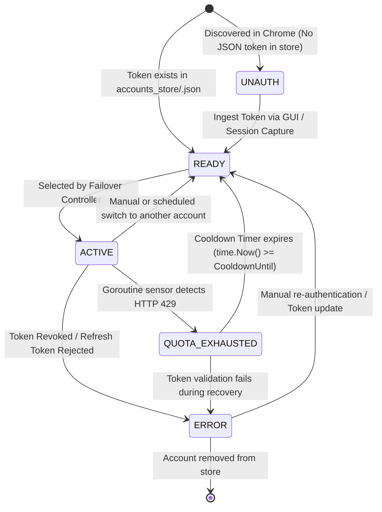
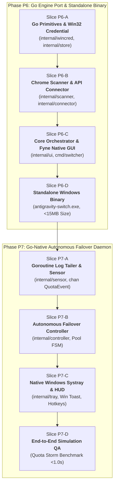

# Architectural Design Report: Go Conversion, Native Standalone Binary & Autonomous Quota Failover Engine (Phases P6 & P7)

**Document Reference:** `reports/architect/2026-10-14-autonomous-quota-failover-architecture.md`  
**Date:** 2026-10-14  
**Author:** System Architect  
**Authority:** Owner Directive via CEO Agent (`403f41a7-0810-44d9-b875-1e08c4ed13a0`)  
**Status:** APPROVED ARCHITECTURAL SPECIFICATION  
**Target Milestones:**  
- **Phase P6:** Go Engine Port, Fyne Native GUI & Standalone Windows Binary (`antigravity-switch.exe`)  
- **Phase P7:** Go-Native Autonomous Quota Failover Daemon & Auto-Switching Engine  

---

## 1. Executive Summary & Problem Statement

### 1.1 The Problem: Rate Limiting as the Primary Bottleneck in Autonomous AI Pair Programming
Modern AI-assisted software development in Google Antigravity relies heavily on high-throughput, multi-turn reasoning and agentic workflows. In complex engineering sessions—where parent agents orchestrate multiple autonomous subagents, run background tool executions, perform code analysis, and stream large diffs—the Google Cloud Code / Gemini backend enforces strict per-account rate limits:
- **HTTP 429 Too Many Requests**: Triggered when request bursts exceed the Requests Per Minute (RPM) threshold.
- **gRPC Code 8 (`RESOURCE_EXHAUSTED`) / SSE Quota Errors**: Triggered when rolling token quotas (Tokens Per Minute - TPM, or daily usage caps) are reached on model endpoints such as `daily-cloudcode-pa.googleapis.com/v1internal:streamGenerateContent`.

When an active developer or autonomous agent hits these limits:
1. **Developer Flow is Shattered**: The IDE abruptly blocks code completion, inline assistants throw modal alerts, and background subagent loops stall mid-execution.
2. **Manual Intervention Overhead**: In existing manual switcher workflows (Phases P1–P4), the developer must manually open the GUI, identify an alternate account, trigger the switch, and re-invoke the failed operation. This takes anywhere from 30 seconds to several minutes of cognitive distraction.
3. **Fragile Session State in Manual Restarts**: If developers attempt to restart the IDE or sign out manually, uncommitted editor buffers, live terminal processes, and ephemeral agent context can be disrupted.
4. **Runtime Footprint of Interpreted Prototypes**: While the Python implementation (Phases P1–P5) proved the feasibility of the 4-step closed-loop internal API switching architecture, running a continuous Python runtime in the background consumes 40MB–80MB RAM, requires an active Python interpreter/virtual environment on the developer's machine, and introduces DLL startup overhead.

### 1.2 UI Design Philosophy: The Pure Developer Tool Doctrine
The Owner has explicitly mandated the UI design philosophy and architecture decision for the Go conversion:
- **Philosophy:** A developer tool must be as lightweight as possible, run as fast as possible. The UI does not need to be fancy, heavy, or bloated; what matters is pure **practicality**—displaying correct, complete information, and executing with 100% reliability.
- **Decision:** Formally select **Fyne (100% Pure Go Native GUI)** and **Native Windows System Tray** as the UI stack for Phase P6. This eliminates external browser engines, Node.js dependencies, and heavy webview components, providing instantaneous rendering with minimal memory footprint.

### 1.3 The Two-Stage Architectural Evolution (Phases P6 & P7)

To solve these challenges permanently and build a production-grade developer tool, the Owner and CEO have established a two-stage roadmap:

```
[ Phases P1 - P5: Python Validation Prototype ]
                     |
                     v
[ Phase P6: High-Performance Go Engine, Fyne Native GUI & Standalone Binary ]
  - Complete port to compiled Go (golang)
  - Pure Go Native GUI (Fyne) with zero web runtime bloat (< 20MB RAM)
  - Standalone single executable: antigravity-switch.exe (10-15MB)
  - Native Win32 Advapi32.dll integration via golang.org/x/sys/windows
  - Zero external runtime dependencies (no Python, no pip, no MSVC runtimes)
  - Ultra-low footprint: < 12MB RAM (daemon) / < 20MB RAM (GUI), < 0.05% CPU
                     |
                     v
[ Phase P7: Go-Native Autonomous Quota Failover Daemon ]
  - Background goroutine log tailer (sniffing language_server.log)
  - High-performance regex / token bucket rate limit interceptor
  - Real-time round-robin account pool with automated cooldown tracking
  - Native Windows System Tray (desktop.App / systray) & discrete Windows Toast notifications
  - 100% Context Preservation: Zero disruption to open tabs, dirty buffers, and chat
```

---

## 2. High-Level Architecture & Component Decomposition

The system is decomposed into cleanly decoupled, high-performance Go packages operating over local OS primitives and Antigravity internals.

```
+-----------------------------------------------------------------------------------+
|                        PHASE P7: GO RESIDENT DAEMON & HUD                         |
|  - System Tray Icon (desktop.App)     - Discrete Windows Toast HUD Notifications  |
|  - Global Hotkeys (RegisterHotKey)    - Inter-Process Control Socket / CLI Pipe   |
+-----------------------------------------------------------------------------------+
                                        |
+-----------------------------------------------------------------------------------+
|                  PHASE P7: GO AUTONOMOUS FAILOVER CONTROLLER                      |
|  - Account Pool FSM (sync.RWMutex)    - Scheduling Policy (Round-Robin / LRU)     |
|  - Cooldown & Recovery Engine         - Anti-Flapping Hysteresis & Debounce Gate  |
+-----------------------------------------------------------------------------------+
             ^                                                   |
             | chan QuotaExhaustedEvent                          | Execute Swap
+-------------------------------------------+   +-----------------------------------+
|     PHASE P7: GO REAL-TIME SENSOR         |   |    PHASE P6: NATIVE GO ENGINE     |
| - Goroutine Non-blocking Log Tailer       |   | - 4-Step Closed-Loop Internal API |
|   (language_server.log)                   |   |   1. GetUserStatus() probe        |
| - Connect-RPC Status Interceptor          |   |   2. AuthLogout() RAM invalidation|
| - DevTools CDP Event Observer             |   |   3. Advapi32 CredWriteW inject   |
| - Event Channel Dispatcher                |   |   4. Coordinated Re-Auth / Reload |
+-------------------------------------------+   +-----------------------------------+
                                        |                        |
+-------------------------------------------+   +-----------------------------------+
|          PHASE P6: FYNE NATIVE GUI        |   |     PHASE P6: NATIVE STORAGE      |
| - Fyne 100% Pure Go Window                |   | - internal/wincred (Advapi32.dll) |
| - Active Account Banner & 1-Click Switch  |   | - internal/store (JSON Atomic)    |
| - Real-time Status Dots & Auto Toggle     |   | - internal/scanner (Chrome pref)  |
+-------------------------------------------+   +-----------------------------------+
```

---

### Phase P6: Native Go Engine Package Architecture (`antigravity-switch.exe`)

The core engine is ported from Python to idiomatic Go, compiled into a single static binary:

```
cmd/
  switcher/
    main.go                   # CLI flags, GUI launcher, daemon entrypoint
internal/
  wincred/
    cred.go                   # Win32 Advapi32 wrapper (CredReadW, CredWriteW, CredDeleteW)
    types.go                  # Windows CREDENTIALW structs and memory allocators
  store/
    account_store.go          # Atomic JSON file storage in accounts_store/<email>.json
    sanitizer.go              # Email filename normalization and path traversal guard
  connector/
    api_client.go             # Loopback HTTP / Connect-RPC client (net/http)
    discovery.go              # language_server.exe PID, port, and --csrf_token extraction
    endpoints.go              # GetUserStatus, AuthLogout, trigger_reauth definitions
  scanner/
    chrome_scanner.go         # Read-only extraction of Chrome profiles with blacklist filter
  reloader/
    session_reloader.go       # Coordinated reload bridge (trigger_reauth + User32 Ctrl+R)
  ui/
    app.go                    # Fyne application lifecycle, dark theme, desktop.App integration
    window.go                 # Main control dashboard: active account banner, pool card list
    widgets.go                # Custom account item widget: status indicator, 1-click switch button
    tray.go                   # Fyne native system tray menu and background minimize handling
```

#### Key Technical Capabilities in Phase P6:
1. **Direct Win32 Advapi32 Integration (`internal/wincred`)**:
   - Replaces Python `ctypes` with `golang.org/x/sys/windows`.
   - Calls `Advapi32.dll` (`CredReadW`, `CredWriteW`, `CredDeleteW`, `CredFree`) directly targeting `LegacyGeneric:target=gemini:antigravity`.
   - Zero intermediate marshal overhead; zero pointer safety issues.

2. **Loopback HTTP & Connect-RPC Client (`internal/connector`)**:
   - Built on Go standard library `net/http` with an optimized connection pool (`MaxIdleConnsPerHost = 4`, `Timeout = 2s`).
   - Dispatches authenticated POST requests with `X-Csrf-Token` and `x-codeium-csrf-token` headers to `http://127.0.0.1:<port>`.
   - Implements robust candidate endpoint fallback for `GetUserStatus`, `AuthLogout`, and `trigger_reauth`.

3. **Atomic File Persistence (`internal/store`)**:
   - Manages `accounts_store/<email>.json` with Go's `os.CreateTemp`, `json.NewEncoder`, `os.File.Sync()`, and `os.Rename()` for transactional, corruption-proof atomicity.

4. **Pure Go Native GUI with Fyne (`internal/ui`)**:
   - 100% pure Go implementation; zero web runtimes (no Node.js, Electron, or Chromium embedded).
   - Practical layout: High-contrast dark theme, active account banner, scrollable account cards with status dots (🟢 Active, 🟢 Ready, 🟡 Unauth), 1-click switch button `[⚡ Chuyển]`, `[💾 Lưu phiên]` button, and Auto-Failover toggle.
   - Cold start in **< 50ms**, resident memory footprint **< 20MB RAM**.

5. **Standalone Binary Compilation**:
   ```bash
   go build -ldflags="-H windowsgui -s -w" -o antigravity-switch.exe cmd/switcher/main.go
   ```
   - `-s -w`: Strips debug symbols and DWARF tables, reducing binary size to 10MB–15MB.
   - `-H windowsgui`: Suppresses terminal console flash when launched from desktop shortcuts or system tray.
   - **Resource Footprint**: Consumes **< 12MB RAM** in daemon mode, **< 20MB RAM** with GUI open, and **< 0.05% CPU**.

---

### Phase P7: Go-Native Autonomous Quota Failover Daemon

Phase P7 layers the autonomous failover intelligence on top of the native Go engine:

```
internal/
  sensor/
    log_tailer.go             # Goroutine tailing language_server.log via incremental seek
    signatures.go             # Regex patterns for 429, RESOURCE_EXHAUSTED, quota limits
    event_bus.go              # Go channel: chan QuotaExhaustedEvent
  controller/
    pool_manager.go           # Thread-safe AccountPool (sync.RWMutex)
    scheduler.go              # Round-robin, LRU, and priority scheduling algorithms
    cooldown.go               # Exponential backoff cooldown tracker with time.Ticker
    hysteresis.go             # Anti-flapping debounce gate and circuit breaker
  tray/
    tray_daemon.go            # Native Windows systray integration (Fyne desktop.App / systray)
    notifications.go          # Windows 10/11 Toast Notification bridge
    hotkeys.go                # Global Win32 hotkey listener (RegisterHotKey)
```

#### Layer 1: Goroutine Quota Detection Sensor (`internal/sensor`)
- Runs a dedicated, non-blocking goroutine executing an incremental file read on `%APPDATA%\Antigravity\logs\language_server.log`.
- Tracks file byte offset; handles log rotation smoothly via file size shrink detection.
- Fast string and regex matching for:
  * `HTTP 429` / `status: 429` / `Too Many Requests`
  * `RESOURCE_EXHAUSTED` / `code: 8`
  * `Quota exceeded for quota metric` / `daily-cloudcode-pa.googleapis.com`
  * `exceeded your current quota` / `rate limit exceeded`
- Emits events directly into an unbuffered Go channel:
  ```go
  type QuotaExhaustedEvent struct {
      Email             string
      Timestamp         time.Time
      ErrorSignature    string
      SourceLayer       string
      SuggestedCooldown time.Duration
  }
  ```

#### Layer 2: Autonomous Failover Controller & Pool Manager (`internal/controller`)
- Manages an in-memory `AccountPool` protected by `sync.RWMutex`.
- Implements the FSM (`ACTIVE`, `READY`, `QUOTA_EXHAUSTED`, `UNAUTH`, `ERROR`).
- Selects the next optimal account via Round-Robin or Least-Recently-Used (LRU).
- Enforces a 15-second anti-flapping minimum dwell time and a rolling-window circuit breaker.

#### Layer 3: Native Hot-Swap Execution
- Reuses the Phase P6 native 4-step loop (`GetUserStatus` ➔ `AuthLogout` ➔ `CredWriteW` ➔ `trigger_reauth`).
- Benchmark target: **< 1.0 second total failover time**.

#### Layer 4: System Tray & Notification Hub (`internal/tray`)
- Runs via Fyne's `desktop.App` / native Windows message loop.
- Tray icon dynamically changes:
  * 🟢 **Green**: Healthy, multiple accounts ready.
  * 🟡 **Yellow**: Active account running; failover in progress or 1 account left.
  * 🔴 **Red**: All accounts cooling down; countdown displayed in tooltip.
- Dispatches Windows Toast alerts on failover completion.
- Listens for global hotkey (`Win+Alt+S`) via Win32 `RegisterHotKey`.

---

## 3. Sequence Diagrams

### End-to-End Autonomous Failover Sequence (Go-Native Runtime)

```mermaid
sequenceDiagram
    autonumber
    actor Dev as Developer / Subagent
    participant IDE as Antigravity Electron Frontend
    participant LS as Language Server (PID: port)
    participant Cloud as Google Cloud Code Backend
    participant Sensor as Goroutine Log Sensor
    participant Ctrl as Failover Controller (Go)
    participant Store as JSON Account Store
    participant WinCred as Windows Credential Manager
    participant Tray as Native System Tray HUD

    Note over Dev, Cloud: 1. Active Working Session
    Dev->>IDE: Send prompt / trigger agentic subagent
    IDE->>LS: streamGenerateContent RPC
    LS->>Cloud: POST /v1internal:streamGenerateContent (Account A)
    
    Note over Cloud, LS: 2. Rate Limit Hit (HTTP 429)
    Cloud-->>LS: HTTP 429 Too Many Requests (RESOURCE_EXHAUSTED)
    LS->>LS: Log error to language_server.log
    
    Note over Sensor, Ctrl: 3. Instantaneous Goroutine Detection (< 20ms)
    Sensor->>Sensor: LogTail reads "HTTP 429 ... RESOURCE_EXHAUSTED"
    Sensor->>Ctrl: channel <- QuotaExhaustedEvent("userA@gmail.com")
    
    Note over Ctrl, Store: 4. Decision & Selection (< 5ms)
    Ctrl->>Ctrl: Lock Pool RWMutex; mark userA QUOTA_EXHAUSTED
    Ctrl->>Ctrl: Check anti-flapping debounce gate (Passed)
    Ctrl->>Store: Get next READY account from pool (Round-Robin)
    Store-->>Ctrl: Selected candidate: "userB@gmail.com"
    
    Note over Ctrl, LS: 5. Native Closed-Loop Hot-Swap Execution (< 800ms)
    Ctrl->>LS: Step 1: POST /GetUserStatus (Confirm active userA)
    LS-->>Ctrl: 200 OK (Confirmed userA)
    
    Ctrl->>LS: Step 2: POST /AuthLogout (Purge RAM identity)
    LS-->>Ctrl: 200 OK (RAM cleared)
    
    Ctrl->>Store: Read token for "userB@gmail.com"
    Store-->>Ctrl: Valid OAuth token struct
    
    Ctrl->>WinCred: Step 3: CredWriteW(LegacyGeneric:target=gemini:antigravity)
    WinCred-->>Ctrl: Success
    
    Ctrl->>LS: Step 4: POST /ReAuth (Trigger RAM token reload)
    LS->>WinCred: CredReadW() -> Ingest userB token
    LS-->>Ctrl: 200 OK (Auth Succeeded)
    
    Note over Ctrl, Tray: 6. Verification & Ambient Notification
    Ctrl->>LS: Verify POST /GetUserStatus
    LS-->>Ctrl: 200 OK (Confirmed userB is ACTIVE)
    Ctrl->>Ctrl: Mark userB as ACTIVE
    Ctrl->>Tray: Show Windows Toast: "Auto-switched to userB in 0.8s"
    Tray-->>Dev: Ambient Toast Notification
    
    Note over Dev, Cloud: 7. Seamless Resumption (Zero Interruption)
    IDE->>LS: Transparent retry of request stream
    LS->>Cloud: POST /v1internal:streamGenerateContent (Account B)
    Cloud-->>LS: HTTP 200 OK (Streaming tokens...)
    LS-->>IDE: Stream response chunks
    IDE-->>Dev: Response rendered in editor / chat
```

---

## 4. Data Structures & State Machine

### 4.1 Account Lifecycle State Machine (Mermaid)



### 4.2 State Machine Descriptions & Invariants

| State | Invariant Condition | Allowed Transitions |
|---|---|---|
| `ACTIVE` | Injected into Windows Credential Manager and active in Language Server RAM. Strictly **one** account in the entire system may be `ACTIVE`. | ➔ `QUOTA_EXHAUSTED` (on 429)<br>➔ `READY` (on handoff)<br>➔ `ERROR` (on token rejection) |
| `READY` | Valid OAuth token saved in `accounts_store/<email>.json`, not currently active, not in cooldown. Ready for immediate hot-swap. | ➔ `ACTIVE` (selected for failover)<br>➔ `ERROR` (if token becomes invalid) |
| `QUOTA_EXHAUSTED` | Rate-limited by Google Cloud Code. `CooldownUntil` timestamp is set in the future. Bypassed by scheduler until expiry. | ➔ `READY` (when `time.Now() >= CooldownUntil`)<br>➔ `ERROR` (if deleted/corrupted) |
| `UNAUTH` | Detected in Chrome profile preferences, but complete OAuth token is not yet captured in `accounts_store/`. | ➔ `READY` (upon user logging into Antigravity or manual import) |
| `ERROR` | Token deserialization failed, refresh token rejected by Google, or file corrupted. | ➔ `READY` (after re-authentication) |

---

### 4.3 Idiomatic Go Data Structures

```go
package model

import (
	"sync"
	"time"
)

type AccountState string

const (
	StateActive         AccountState = "ACTIVE"
	StateReady          AccountState = "READY"
	StateQuotaExhausted AccountState = "QUOTA_EXHAUSTED"
	StateUnauth         AccountState = "UNAUTH"
	StateError          AccountState = "ERROR"
)

type TokenData struct {
	AccessToken  string    `json:"access_token"`
	RefreshToken string    `json:"refresh_token"`
	IDToken      string    `json:"id_token,omitempty"`
	TokenType    string    `json:"token_type,omitempty"`
	Expiry       time.Time `json:"expiry,omitempty"`
}

type AccountRecord struct {
	Email                  string       `json:"email"`
	State                  AccountState `json:"state"`
	Token                  *TokenData   `json:"token,omitempty"`
	LastSwitchedAt         time.Time    `json:"last_switched_at"`
	CooldownUntil          time.Time    `json:"cooldown_until"`
	ConsecutiveExhaustions int          `json:"consecutive_exhaustions"`
	TotalSwitches          int          `json:"total_switches"`
	ErrorMessage           string       `json:"error_message,omitempty"`
}

func (a *AccountRecord) IsEligibleForSwitch() bool {
	return a.State == StateReady
}

func (a *AccountRecord) MarkExhausted(baseCooldown time.Duration) {
	a.State = StateQuotaExhausted
	a.ConsecutiveExhaustions++
	// Exponential backoff: 15m -> 30m -> 60m (capped at 2 hours)
	multiplier := 1 << (min(a.ConsecutiveExhaustions, 4) - 1)
	a.CooldownUntil = time.Now().Add(baseCooldown * time.Duration(multiplier))
}

func (a *AccountRecord) CheckCooldownExpiry() bool {
	if a.State == StateQuotaExhausted && time.Now().After(a.CooldownUntil) {
		a.State = StateReady
		a.CooldownUntil = time.Time{}
		return true
	}
	return false
}

type AccountPool struct {
	mu       sync.RWMutex
	accounts map[string]*AccountRecord
	order    []string
}

type FailoverConfig struct {
	MinDwellTime           time.Duration `json:"min_dwell_time"`            // Default: 15s
	MaxSwitchesPerWindow   int           `json:"max_switches_per_window"`   // Default: 4
	SlidingWindowDuration  time.Duration `json:"sliding_window_duration"`  // Default: 120s
	DefaultCooldown        time.Duration `json:"default_cooldown"`         // Default: 15m
	AutoWindowReload       bool          `json:"auto_window_reload"`        // Default: false (API reauth primary)
	EnableNotifications    bool          `json:"enable_notifications"`     // Default: true
}
```

---

## 5. Edge Case & Safety Engineering

### 5.1 Flapping & Thrashing Prevention (Hysteresis Engine)
- **Minimum Dwell Time**: The controller enforces a strict **15-second minimum interval** between consecutive switches. Any incoming quota event during this window is debounced.
- **Circuit Breaker Window**: If more than 4 switches occur within 120 seconds, automated switching pauses for 60 seconds, preventing cascading exhaustion of all accounts in the pool.

### 5.2 "All Accounts Exhausted" Pool Depletion Handling
- When all accounts are `QUOTA_EXHAUSTED`, the engine calculates:
  $$\Delta t_{\text{wake}} = \min_{a \in \text{Pool}} (a.\text{CooldownUntil}) - \text{time.Now}()$$
- The daemon transitions to `EXHAUSTED_SLEEP`, turns the tray icon solid red, and presents a countdown tooltip.
- A high-precision `time.AfterFunc` automatically wakes the controller and fails over to the first recovered account immediately upon cooldown expiry.

### 5.3 Context Preservation Guarantee: Zero Impact on IDE State
1. **Backend-Only Identity Handoff**: `AuthLogout()` and `trigger_reauth()` operate exclusively inside the Golang `language_server.exe` process.
2. **Frontend Isolation**: The Electron frontend (`antigravity.exe`) maintains all Monaco editor instances, unsaved text buffers (`isDirty = true`), open terminal PTY sessions, and chat conversation DOM elements 100% intact.
3. Only outbound authorization tokens (`Bearer <access_token>`) are updated. No windows are closed, no processes killed.

---

## 6. Phased Implementation Roadmap



---

### Phase P6: Go Engine Port & Standalone Native Windows Binary (`antigravity-switch.exe`)

The objective of Phase P6 is to deliver a compiled, standalone, zero-dependency Windows executable replacing the Python runtime.

#### Slice P6-A: Go Core Primitives & Native Win32 Credential Layer
- **Deliverables**:
  - `go.mod` module initialization (`module antigravity-switch`).
  - `internal/wincred`: `Advapi32.dll` wrapper using `golang.org/x/sys/windows` (`CredReadW`, `CredWriteW`, `CredDeleteW`, `CredFree`).
  - `internal/store`: Atomic JSON file storage in `accounts_store/<email>.json` with filename sanitation and path traversal protection.
- **Verification Gates**:
  - Direct round-trip unit tests reading and writing `LegacyGeneric:target=gemini:antigravity`.
  - Concurrency and file corruption resilience tests.

#### Slice P6-B: Chrome Discovery Scanner & Language Server Connector
- **Deliverables**:
  - `internal/scanner`: Fast Chrome profile preference reader with strict `anvien` blacklist filtering.
  - `internal/connector`: Language server process discovery (PID, listening port via `Get-NetTCPConnection` / Win32 API, `--csrf_token` regex).
  - High-efficiency `net/http` loopback client for `GetUserStatus`, `AuthLogout`, and `trigger_reauth`.
- **Verification Gates**:
  - Live discovery test on running `language_server.exe` PID.
  - Mock HTTP server tests for RPC status parsing, 401/403/500 resilience, and timeout handling.

#### Slice P6-C: Core Orchestrator & Fyne Native GUI (`internal/ui`, `cmd/switcher`)
- **Deliverables**:
  - `internal/reloader`: Coordinated reload bridge (API reauth primary, User32 `keybd_event Ctrl+R` fallback).
  - `internal/manager`: Port of `AccountManager` coordinating Chrome discovery, store, credentials, and 4-step hot-swap.
  - `internal/ui`: Fyne 100% Pure Go Native GUI (`app.go`, `window.go`, `widgets.go`, `tray.go`):
    * Dark theme dashboard matching IDE aesthetics.
    * Active account banner with live RAM verification badge.
    * Scrollable card list with status indicators (🟢 Active, 🟢 Ready, 🟡 Unauth) and 1-click switch buttons.
    * Auto-Failover toggle and manual capture buttons.
    * System Tray integration via `desktop.App` with minimize-to-tray.
  - `cmd/switcher/main.go`: Dual CLI / GUI entrypoint with flags (`--gui`, `--cli`, `--switch <email>`).
- **Verification Gates**:
  - GUI cold boot in **< 50ms**, resident memory footprint **< 20MB RAM**.
  - Live execution of 4-step hot-swap via 1-click GUI switch button.
  - Verified RAM email identity update confirmed via `GetUserStatus`.

#### Slice P6-D: Standalone Windows Binary Compilation & Benchmark
- **Deliverables**:
  - Build script: `go build -ldflags="-H windowsgui -s -w" -o antigravity-switch.exe cmd/switcher/main.go`.
  - Static embedding of icons and manifests using Windows resource compiler (`rsrc` / `windres`).
  - Performance benchmarking suite.
- **Verification Gates**:
  - Single standalone binary output (`antigravity-switch.exe`, 10MB–15MB).
  - Startup time $\le 10\text{ms}$; resident memory footprint **$\le 12\text{MB}$ RAM (CLI/daemon) / $\le 20\text{MB}$ RAM (GUI)**; zero external DLL dependencies.

---

### Phase P7: Go-Native Autonomous Quota Failover Daemon

Building directly on top of the Phase P6 native engine, Phase P7 introduces the background autonomous monitoring daemon.

#### Slice P7-A: Goroutine Log Tailer & Quota Sensor Pipeline
- **Deliverables**:
  - `internal/sensor/log_tailer.go`: Non-blocking goroutine continuously tailing `language_server.log`.
  - High-speed string and regex matcher for HTTP 429, gRPC `RESOURCE_EXHAUSTED`, and quota error signatures.
  - `internal/sensor/event_bus.go`: Event channel piping `QuotaExhaustedEvent` to controller.
- **Verification Gates**:
  - Simulated log append tests with 100,000 synthetic log lines; detection latency $\le 20\text{ms}$, CPU usage $\le 0.05\%$.

#### Slice P7-B: Go-Native Failover Controller & Account Pool FSM
- **Deliverables**:
  - `internal/controller/pool_manager.go`: Thread-safe `AccountPool` (`sync.RWMutex`).
  - `internal/controller/scheduler.go`: Round-robin and LRU account selection with exponential cooldown backoff.
  - `internal/controller/hysteresis.go`: 15s minimum dwell time and sliding-window circuit breaker.
  - Automated trigger of the Phase P6 4-step hot-swap engine upon valid quota events.
- **Verification Gates**:
  - Simulation tests for single account exhaustion, multi-account cycling, and flapping storm suppression.

#### Slice P7-C: Native Windows System Tray & Toast HUD
- **Deliverables**:
  - `internal/tray/tray_daemon.go`: System tray application using Fyne `desktop.App` / native Win32 message loop with dynamic icons (🟢 / 🟡 / 🔴).
  - Context menu for pool status, active account, manual switch override, and pause/resume toggle.
  - Windows 10/11 Toast Notification bridge for discrete hot-swap alerts.
  - Global hotkey listener (`Win+Alt+S`) via Win32 `RegisterHotKey`.
- **Verification Gates**:
  - Tray icon runs cleanly in background; hotkeys and notifications execute with zero UI freezes.

#### Slice P7-D: End-to-End Simulation QA & Quota Storm Stress Testing
- **Deliverables**:
  - Full end-to-end integration test harness.
  - Quota Storm Stress Test: Rapid injection of 429 errors into mock logs, verifying clean rotation through 3 accounts, adherence to 15s hysteresis, and graceful sleep upon total exhaustion.
  - Benchmark: Complete automated failover cycle executed in **$< 1.0\text{ second}$**.
- **Verification Gates**:
  - 100% test pass rate across all integration test suites.
  - Verified 100% IDE context preservation (open editor tabs, unsaved buffers, terminals unaffected).

---

## 7. Architectural Decision Records (ADR) Summary

| ADR ID | Decision Title | Decision Made | Rationale | Alternatives Considered & Rejected |
|---|---|---|---|---|
| **ADR-P6-01** | Production Language & Runtime | Port engine to Go (Golang) compiled binary (`antigravity-switch.exe`) | Standalone binary (10-15MB), zero Python/pip dependencies, instant startup, < 12MB RAM footprint. | Retaining Python runtime (high 50-80MB RAM overhead, requires local Python environment, slower startup). |
| **ADR-P6-02** | Win32 Credential API Binding | Direct Win32 via `golang.org/x/sys/windows` | Clean, native, type-safe integration with `Advapi32.dll` with zero CGo requirement. | CGo wrapper (requires C compiler/MSVC toolchain, complicates cross-compilation). |
| **ADR-P6-03** | Internal Auth API Communication | Go standard library `net/http` | Zero-dependency, thread-safe, high-performance connection reuse for loopback RPC. | Third-party HTTP client libraries (unnecessary bloat for simple loopback JSON POSTs). |
| **ADR-P6-05** | Native GUI Framework Selection | **Fyne (100% Pure Go Native GUI) & `desktop.App`** | Single-language Go stack, instant cold boot (< 50ms), minimal footprint (< 20MB RAM), hardware accelerated, high practicality. | Electron (200MB+ bloat); Wails/Webview (introduces CGO/webview2/web runtime complexity). |
| **ADR-P7-01** | Real-Time Quota Detection | Goroutine Log Tailer on `language_server.log` via Go channels | Native Go channels provide sub-millisecond, lock-free event delivery with zero polling CPU waste. | Reverse proxy / MITM loopback listener (intrusive, TLS interception risks). |
| **ADR-P7-02** | Desktop Tray & Alerting | Fyne `desktop.App` System Tray + Windows Toast API | Extremely lightweight native integration without heavy webview or browser runtimes. | Electron / Web-based background daemons (excessive resource overhead). |

---

### Detailed Architectural Decision Record: ADR-P6-05

#### Title: Selection of Fyne (Pure Go Native GUI) over Electron / WebViews

- **Status:** APPROVED  
- **Context:**  
  A developer desktop switcher tool requires an intuitive, zero-friction interface for reviewing detected accounts, monitoring real-time active status, executing one-click manual switches, and toggling autonomous failover.
  
- **Alternatives Evaluated:**
  1. *Electron (Node.js + Chromium)*:
     - **Rejected**: Consumes **200MB–350MB RAM**, adds 80MB+ to binary installer, requires separate Node runtime, and takes 1.5s–3s to launch. Unacceptable for a lightweight background developer utility.
  2. *Wails / Webview2 (Go Backend + HTML/JS/CSS Frontend)*:
     - **Rejected**: While lighter than Electron (~50MB RAM), Wails still requires Windows WebView2 Evergreen runtime dependencies, requires CGO compilation on Windows, introduces npm/frontend asset toolchains, and increases build complexity.
  3. *Fyne (100% Pure Go Native GUI)*:
     - **Selected**: Compiles cleanly with standard Go toolchain, renders via native OpenGL/DirectX hardware acceleration, has an ultra-lightweight memory footprint (**< 20MB RAM**), launches in **< 50ms**, and embeds native system tray support directly via `desktop.App`.

- **Rationale:**
  - **Developer Tool Philosophy Alignment**: Matches the Owner's mandate that developer tooling must be as lightweight and fast as possible, emphasizing pure practicality, truthful and complete information display, and 100% execution reliability over visual bloat.
  - **Single Language & Zero Toolchain Friction**: Entire project remains 100% Go from top to bottom (backend, storage, API, and UI). No Node.js, no npm, no webpack.
  - **Native System Tray Integration**: Fyne provides direct `desktop.App` interfaces (`SetSystemTrayMenu`, `SetSystemTrayIcon`) enabling seamless background residency with minimize-to-tray behavior.

- **UI Architecture Specification:**
  - **Window Dimensions**: Compact $440 \times 560\text{ px}$ dark-themed window.
  - **Header Section**: Active Account Card with prominent green status dot, live verified email from `GetUserStatus()`, and active session indicator.
  - **Toolbar Controls**: `[🔄 Làm mới Chrome]`, `[💾 Lưu phiên]`, and `[⚡ Auto-Failover: BẬT/TẮT]` toggle switch.
  - **Account List**: Scrollable list of accounts discovered across Chrome and `accounts_store/`. Each item renders:
    * Status Dot (🟢 Active, 🟢 Ready, 🟡 Unauth)
    * Email address & profile source
    * Direct Action Button (`[⚡ Chuyển sang]` for Ready accounts, `[💾 Lưu phiên]` for active unsaved)
  - **Status Footer**: Real-time Language Server connection indicator (`PID: <pid> | Port: <port> | Status: Sẵn sàng`).

---

## 8. Conclusion

This finalized architectural blueprint integrates the Owner's mandate:
1. **Phase P6** delivers immediate enterprise-grade durability by compiling the core switcher into a native, standalone, high-performance Windows binary (`antigravity-switch.exe`) with a pure Go native Fyne GUI (< 20MB RAM, < 50ms startup, zero webview bloat).
2. **Phase P7** unlocks autonomous, self-healing continuous AI coding by deploying a lightweight Go goroutine daemon that detects quota exhaustion instantly and performs hot-swaps under 1 second with 100% IDE context preservation.
