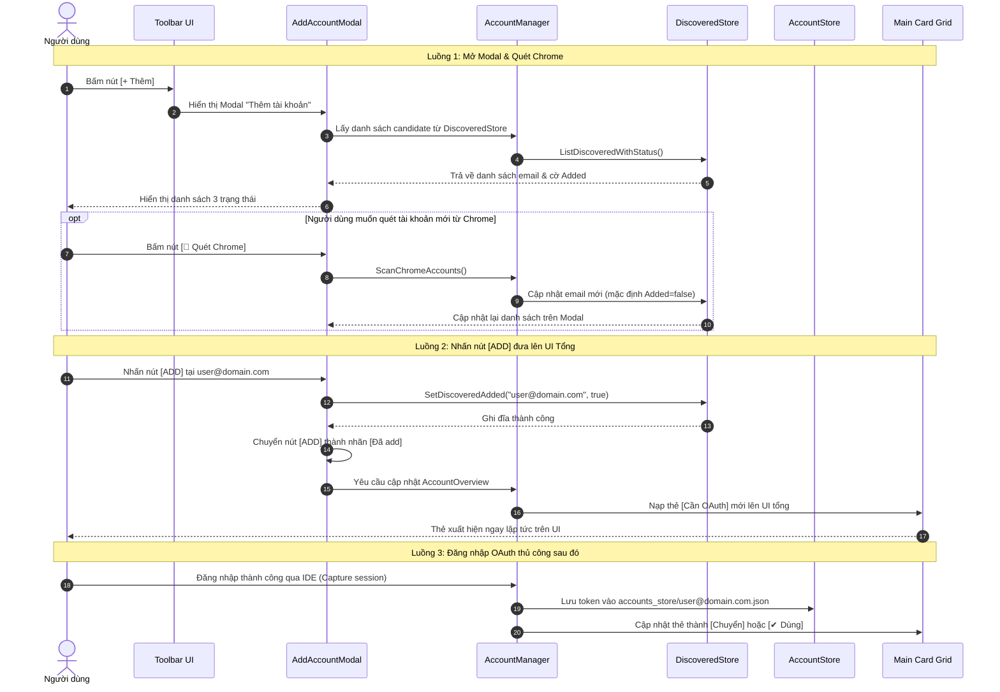

# SPEC-ARCH-20261022: Modal Thêm Tài Khoản và Cơ Chế Lọc Danh Bạ Chrome

- **Tài liệu:** Kiến trúc Kỹ thuật (Architectural Specification)
- **Tác giả:** System Architect
- **Ngày lập:** 2026-10-22
- **Trạng thái:** DRAFT / ĐÃ THỐNG NHẤT VỚI OWNER
- **Mục tiêu:** Tách rời cơ chế quét Chrome khỏi cơ chế hiển thị UI tổng, cung cấp Modal `[+ Thêm]` với 3 trạng thái rõ ràng, và lưu vết bền vững các tài khoản đang chờ nạp token.

---

## 1. Bối cảnh & Vấn đề Cốt lõi (Problem Statement)

1. **Trộn lẫn Quét Chrome và Hiển thị UI:**
   - Trong kiến trúc cũ, hàm `GetAccountStates` tự động kích hoạt `ScanChromeAccountDetails` ở mọi sự kiện: khi khởi động ứng dụng (`Init`), sau khi chuyển tài khoản thủ công, sau khi auto-switch.
   - Bất kỳ tài khoản nào tìm thấy trong profile Chrome trên máy đều bị tự động nạp vào `discovered_accounts/` và đẩy thẳng lên UI tổng dưới dạng thẻ `[Cần OAuth]`.
   - Điều này gây ra "ô nhiễm thị giác": người dùng có hàng chục email phụ trên Chrome không bao giờ dùng cho Antigravity cũng bị ép hiển thị kín màn hình.

2. **Yêu cầu Kiến trúc Mới (Owner Directives):**
   - **Tách rời hoàn toàn:** Quét Chrome chỉ cập nhật vào danh bạ ứng viên `discovered_accounts/`, tuyệt đối không tự ý đẩy lên UI tổng.
   - **Lọc UI tổng:** Giao diện chính chỉ hiển thị các tài khoản đã có token (`accounts_store/`), tài khoản đang Active, và các tài khoản mà người dùng **chủ động bấm [ADD]**.
   - **Modal `[+ Thêm]`:** Cung cấp giao diện quản lý danh bạ ứng viên từ `discovered_accounts/` với 3 trạng thái phân cấp (`[Đã OAuth]`, `[Cần OAuth]` kèm nút `[ADD]`, và `[Đã add]`).
   - **Ghi nhớ bền vững (Phương án 1):** Khi người dùng bấm `[ADD]`, cờ `added: true` được lưu vào đĩa để khi khởi động lại ứng dụng, thẻ `[Cần OAuth]` vẫn giữ nguyên trên UI tổng nhắc người dùng tiếp tục đăng nhập.

---

## 2. Các Bất Biến Kiến Trúc (Architectural Invariants)

### Invariant-Chrome-Scan-Decoupling (Phân tách Quét Chrome)
- **Quy tắc:** Tuyệt đối không quét thư mục profile Chrome trong quá trình khởi động app (`Init`), sau khi chuyển tài khoản (manual switch), hoặc sau khi auto-switch.
- **Điểm kích hoạt:** Quét Chrome là thao tác **theo yêu cầu (On-Demand)**, chỉ được kích hoạt khi người dùng nhấn nút `[🔄 Quét Chrome]` bên trong Modal Thêm tài khoản.

### Invariant-Discovered-Account-Schema (Cấu trúc Danh bạ Chrome)
- **Quy tắc:** Schema `DiscoveredAccountEnvelope` trong `internal/store/discovered_store.go` được mở rộng trường `Added bool`:
  ```go
  type DiscoveredAccountEnvelope struct {
      Email     string  `json:"email"`
      ScannedAt float64 `json:"scanned_at"`
      Added     bool    `json:"added,omitempty"`
  }
  ```
- **Hành vi:**
  - Khi quét Chrome lần đầu: `Added = false`.
  - Khi người dùng nhấn nút `[ADD]` trong Modal: `Added` chuyển thành `true` và được ghi bền vững vào file `discovered_accounts/<email>.json`.

### Invariant-UI-Account-Filtering (Lọc Danh Sách Thẻ Trên UI Tổng)
- **Quy tắc:** UI tổng chỉ hiển thị danh sách thẻ hợp nhất từ 3 nguồn:
  1. Tất cả tài khoản có file JSON hợp lệ trong `accounts_store/` (nhãn `[Chuyển]` hoặc `[✔ Dùng]`).
  2. Tài khoản đang Active trong Windows Credential Manager / RAM (nhãn `[✔ Dùng]`).
  3. Các tài khoản trong `discovered_accounts/` có cờ `Added == true` mà chưa có trong `accounts_store/` (nhãn `[Cần OAuth]`).
- **Nghiêm cấm:** Không hiển thị bất kỳ tài khoản nào từ `discovered_accounts/` nếu `Added == false`.

### Invariant-Add-Account-Modal-UX (Quy chuẩn Modal Thêm Tài Khoản)
- **Quy tắc:** Modal được mở khi nhấn nút `[+ Thêm]` trên thanh Toolbar chính.
- **Bố cục Modal:**
  - **Header:** Tiêu đề *"Thêm tài khoản"* + Nút nhỏ `[🔄 Quét Chrome]` (icon `theme.ViewRefreshIcon()`).
  - **Danh sách tài khoản:** Liệt kê toàn bộ email có trong `discovered_accounts/`, mỗi dòng gồm email và một trong 3 trạng thái loại trừ lẫn nhau:
    1. **`[Đã OAuth]`**: Áp dụng khi email đã tồn tại trong `accounts_store/` hoặc đang Active. Không hiển thị nút `[ADD]`.
    2. **`[Cần OAuth]` + Nút `[ADD]`**: Áp dụng khi email chưa có token trong `accounts_store/` và `Added == false`. Khi bấm `[ADD]`, cập nhật `Added = true`, thêm thẻ `[Cần OAuth]` lên UI tổng, và chuyển trạng thái dòng thành `[Đã add]`.
    3. **`[Đã add]`**: Áp dụng khi email chưa có token nhưng đã có `Added == true`. Không cho bấm `[ADD]` thêm lần nữa.
  - **Footer:** Nút `[Đóng]` để đóng Modal.

### Invariant-Pending-Account-Persistence (Bảo toàn Thẻ Đang Chờ)
- **Quy tắc:** Trạng thái `Added == true` được lưu bền vững trên đĩa. Khi ứng dụng tắt và mở lại, các thẻ `[Cần OAuth]` đã add vẫn được hiển thị trên UI tổng.
- **Chuyển dịch trạng thái:** Khi người dùng mở Antigravity IDE và hoàn tất đăng nhập thủ công cho email đó, token được nạp vào `accounts_store/` -> thẻ tự động chuyển từ `[Cần OAuth]` sang `[Chuyển]` / `[✔ Dùng]`.

---

## 3. Thiết Kế Luồng Dữ Liệu & Ranh Giới Module (Data Flow & Boundaries)



---

## 4. Hợp Đồng API & Dữ Liệu Nội Bộ (Contracts)

### 4.1. Mở rộng `internal/store/discovered_store.go`
- Bổ sung trường `Added bool` vào `DiscoveredAccountEnvelope`.
- Bổ sung hàm:
  - `SetDiscoveredAdded(email string, added bool) error`: Đọc envelope tương ứng, gán `Added = added`, ghi atomic file ra đĩa.
  - `ListDiscoveredEnvelopes() ([]DiscoveredAccountEnvelope, error)`: Trả về danh sách đầy đủ struct bao gồm email và cờ `Added`.

### 4.2. Điều chỉnh `internal/manager/account_manager.go`
- Tách chức năng quét Chrome ra khỏi `GetAccountStates`:
  - `ScanChromeAccounts() ([]string, error)`: Chỉ quét Chrome profile và ghi vào `discoveredStore`. Không sửa đổi `accounts_store`.
  - `GetAccountStates(ctx context.Context) (*AccountOverview, error)`:
    + Đọc `accounts_store/`.
    + Đọc phiên active từ Windows Credential Manager / Language Server.
    + Đọc `discoveredStore`: **Chỉ gom các email có `Added == true`**.
    + Loại bỏ lệnh gọi `scanner.ScanChromeAccountDetails` khỏi hàm này.

### 4.3. Bổ sung Giao Diện `internal/ui/add_modal.go`
- Struct `addAccountModal`:
  - Quản lý cửa sổ popup / dialog của Fyne.
  - Chứa danh sách cuộn các dòng tài khoản.
  - Callback phản hồi khi nhấn `[ADD]` để đồng bộ ngay lập tức sang `a.updateUI(overview)`.
  - Nút Refresh quét Chrome với feedback icon xoay / loading trạng thái.

### 4.4. Cập nhật Toolbar `internal/ui/window.go`
- Bổ sung nút `[+ Thêm]` vào `toolbarLeft` (Header Row 2):
  ```text
  [Hoạt động | PID ...] [ [+ Thêm] [Làm mới Quota] [📌] ] ...
  ```

---

## 5. Kế Hoạch Xác Minh & Kiểm Thử (Verification Plan)

| ID | Kịch Bản Kiểm Thử | Tiêu Chuẩn Đạt (Acceptance Criteria) |
|---|---|---|
| **TC-01** | Khởi động ứng dụng sạch | UI tổng chỉ hiển thị tài khoản từ `accounts_store/` và active email. Toàn bộ tài khoản Chrome chưa add không được phép xuất hiện. |
| **TC-02** | Mở Modal `[+ Thêm]` | Modal hiển thị chính xác các tài khoản trong `discovered_accounts/`. Tài khoản đã có token hiển thị `[Đã OAuth]`. Tài khoản chưa add hiển thị `[Cần OAuth]` kèm nút `[ADD]`. |
| **TC-03** | Bấm nút `[ADD]` trong Modal | Thẻ `[Cần OAuth]` xuất hiện ngay lập tức trên UI tổng. Nút `[ADD]` trong Modal lập tức chuyển thành nhãn `[Đã add]`. |
| **TC-04** | Kiểm tra tính bền vững (Restart App) | Tắt ứng dụng và mở lại -> Thẻ `[Cần OAuth]` vừa add vẫn hiển thị nguyên vẹn trên UI tổng. |
| **TC-05** | Bấm nút `[🔄 Quét Chrome]` | Quét các profile Chrome, nạp thêm email mới vào `discovered_accounts/`, danh sách trong Modal cập nhật lại; UI tổng không bị thêm tài khoản tự động. |
| **TC-06** | Hoàn tất OAuth sau khi add | Sau khi có file trong `accounts_store/`, thẻ trên UI tổng chuyển thành `[Chuyển]` hoặc `[✔ Dùng]`; trong Modal chuyển thành `[Đã OAuth]`. |
| **TC-07** | Hiệu năng khởi động & chuyển tài khoản | Không quét Chrome khi khởi động app hoặc khi chuyển tài khoản -> thời gian phản hồi tức thì (< 50ms). |
