# BÁO CÁO ĐẶC TẢ KIẾN TRÚC CHI TIẾT (SYSTEM ARCHITECTURE SPECIFICATION)
## Thiết Kế Cơ Chế Giám Sát Trạng Thái Hoạt Động Của Antigravity (Process Liveness Watcher) & Phục Hồi Tính Động Cho Footer UI

- **Mã tài liệu:** `rp_system-architect_261024_footer_ui_antigravity_status_liveness`
- **Tác giả:** System Architect (Strategic Lane)
- **Ngày lập:** 2026-10-24
- **Thẩm quyền phê duyệt:** Human Owner & CEO Agent
- **Trạng thái:** PRODUCTION-READY BLUEPRINT (Khóa cứng Touch-Map & Quy cách kỹ thuật chìa khóa trao tay cho Coder)
- **Mục tiêu tối thượng:**
  1. Khắc phục triệt để hiện tượng nhãn Footer UI (`Antigravity: Hoạt động` / `Không hoạt động`) bị "đóng băng" (stale/frozen state), không tự động chuyển đổi khi Antigravity IDE hoặc tiến trình `language_server.exe` bị tắt/thoát bên ngoài hệ thống.
  2. Thiết kế giải pháp **Background Liveness Watcher** chạy nền định kỳ (2.0s - 2.5s) bằng Win32 API thuần (`PROCESS_QUERY_LIMITED_INFORMATION`, `GetExitCodeProcess`), đạt chuẩn **Near-Zero CPU (< 0.01%)** và **Zero RAM Heap Allocations**.
  3. Bảo tồn tuyệt đối 100% các bất biến hệ thống: Quy trình chờ đủ 8 giây (`waitDuration = 8s`), phòng ngừa Race Condition/Deadlock với `discCache.mu`, và tránh xung đột với luồng Auto-Switch / Manual Refresh (`a.isBusy`).
  4. Khóa cứng Touch-Map và cung cấp bộ tiêu chuẩn kiểm thử chấp nhận (Acceptance Suite) độc lập.

---

# PHẦN 1: BÁO CÁO HIỆN TRẠNG & PHÂN TÍCH NGUYÊN NHÂN GỐC RỄ (FORENSIC ROOT CAUSE)

Qua khảo sát toàn diện mã nguồn tại các module [`internal/ui/`](file:///g:/antigravity_auto_switch/internal/ui/), [`internal/connector/`](file:///g:/antigravity_auto_switch/internal/connector/), và [`internal/manager/`](file:///g:/antigravity_auto_switch/internal/manager/), Kiến trúc sư xác định các bằng chứng kỹ thuật sau:

### 1.1. Hiện trạng cập nhật nhãn Footer UI hiện tại
- Tại [`internal/ui/window.go:266-271`](file:///g:/antigravity_auto_switch/internal/ui/window.go#L266-L271), nhãn trạng thái `a.serverStatusLabel` được gắn cố định tại mép trái của thanh đáy (Footer Bar) trong container `footerContent`.
- Khi khởi tạo ứng dụng (`Init()`), `serverStatusLabel` nhận giá trị ban đầu là `d.ServerConnecting` (`"Antigravity: Hoạt động  | Đang kết nối..."`).
- Việc cập nhật nội dung nhãn sau đó chỉ diễn ra bên trong hàm [`a.updateUI(overview)`](file:///g:/antigravity_auto_switch/internal/ui/app.go#L1586-L1607):
  ```go
  d := i18n.Current()
  if overview.LanguageServerRunning && overview.ServerInfo != nil {
      if isFooterBarTest {
          a.serverStatusLabel.SetText(fmt.Sprintf("Antigravity: Hoạt động  | PID %d | Port %d", overview.ServerInfo.PID, overview.ServerInfo.Port))
      } else {
          a.serverStatusLabel.SetText(fmt.Sprintf(d.ServerConnected, overview.ServerInfo.PID, overview.ServerInfo.Port))
      }
  } else {
      a.serverStatusLabel.SetText(d.ServerStopped) // "Antigravity: Không hoạt động  | Dự phòng WinCred"
  }
  ```

### 1.2. Chuỗi sự kiện gây ra lỗi "Đóng Băng" (Frozen/Stale Label)
Nguyên nhân gốc rễ (Root Cause) không phải do nhãn bị hardcode cố định, mà xuất phát từ **sự thiếu vắng hoàn toàn của cơ chế giám sát liveness chủ động**:
1. **Tính chất thụ động rời rạc của `updateUI`:**
   Hàm `updateUI` chỉ được kích hoạt khi có thao tác người dùng rõ ràng:
   - Người dùng click nút **[Làm mới danh sách]** (`a.Refresh()`).
   - Người dùng thực hiện **[Chuyển tài khoản]** (`a.switchAccount(...)`).
   - Người dùng click **[Thêm tài khoản]** (`AddAccountDialog`).
   - Người dùng đổi ngôn ngữ từ dropdown (`a.langSelect.OnChanged`).
2. **Vòng lặp ngầm 60s (`autoLoop`) tái sử dụng snapshot tĩnh:**
   Tại [`internal/ui/app.go:556-561`](file:///g:/antigravity_auto_switch/internal/ui/app.go#L556-L561), vòng lặp telemetry chạy mỗi 60 giây chỉ phục vụ cập nhật hạn mức quota. Khi cập nhật giao diện, nó lấy lại `a.overview` tĩnh đã lưu từ trước trong RAM:
   ```go
   a.mu.RLock()
   overview := a.overview
   a.mu.RUnlock()
   if overview != nil {
       a.updateUI(overview) // Truyền lại overview cũ, LanguageServerRunning vẫn là true!
   }
   ```
   Vòng lặp này hoàn toàn không quét lại tiến trình hệ thống, không kích hoạt discovery, do đó tiếp tục vẽ lại thông tin của tiến trình cũ.
3. **Không có Process Liveness Listener:**
   Toàn bộ ứng dụng không có bất kỳ goroutine nền nào lắng nghe hoặc thăm dò định kỳ tiến trình `language_server.exe`. Khi người dùng tắt Antigravity IDE (hoặc Antigravity bị crash/đóng), hệ thống không hề hay biết. Biến `a.overview.LanguageServerRunning` trong RAM vẫn là `true`, và nhãn Footer tiếp tục hiển thị `Antigravity: Hoạt động | PID <PID_cũ> | Cổng <Port_cũ>` mãi mãi cho đến khi người dùng bấm nút làm mới bằng tay.

---

# PHẦN 2: NGUYÊN TẮC BẤT BIẾN & RÀNG BUỘC KIẾN TRÚC (ARCHITECTURAL INVARIANTS)

Coder bắt buộc phải tuân thủ nghiêm ngặt 6 nguyên tắc bất biến kiến trúc sau đây:

```
+-------------------------------------------------------------------------------------------------------+
|                                    6 BẤT BIẾN KIẾN TRÚC BẮT BUỘC                                     |
+-------------------------------------------------------------------------------------------------------+
| 1. Pure Win32 & Near-Zero CPU Invariant: Cấm spawn subprocess, chỉ dùng Win32 API thuần (< 0.01% CPU).|
| 2. Thread-Safety & Deadlock-Free Fyne Invariant: Chỉ gọi UI qua fyne.Do, cấm lồng lock với discCache. |
| 3. Non-Interference with In-Flight Switch (8s Invariant): Bỏ qua polling khi a.isBusy == true.        |
| 4. Edge-Triggered Debounce Invariant: Chỉ cập nhật Fyne UI khi trạng thái thực sự biến đổi.           |
| 5. Bilingual i18n & Test Compatibility Invariant: Lấy chuỗi qua i18n.Current() và tương thích test.   |
| 6. Clean Lifecycle & Graceful Teardown Invariant: Dừng ticker và cancel context khi app.Close().      |
+-------------------------------------------------------------------------------------------------------+
```

### 1. Pure Win32 & Near-Zero CPU Overhead Invariant (BẤT BIẾN HIỆU NĂNG)
- Khi kiểm tra liveness của một tiến trình đã biết PID:
  - Bắt buộc dùng trực tiếp Win32 syscalls: `windows.OpenProcess(windows.PROCESS_QUERY_LIMITED_INFORMATION, false, pid)` và `windows.GetExitCodeProcess(hProcess, &exitCode)`.
  - Kiểm tra điều kiện `exitCode == 259` (`STILL_ACTIVE`).
  - Đóng handle ngay lập tức bằng `windows.CloseHandle(hProcess)`.
  - Tuyệt đối KHÔNG spawn các tiến trình ngoài như `tasklist.exe`, `powershell.exe`, `cmd.exe` hoặc gọi WMI.
  - Chu kỳ polling chuẩn: **2.0 giây**. Thời gian thực thi cho một lần kiểm tra PID trên Windows là ~0.02ms, mức chiếm dụng CPU thực tế đạt mức < 0.001% của một nhân CPU.

### 2. Thread-Safety & Deadlock-Free Fyne UI Event Loop Invariant (BẤT BIẾN BẢO VỆ GIAO DIỆN)
- **Nguyên tắc phân tầng khóa:**
  - `a.mu` bảo vệ state nội bộ của `App` (`a.overview`, `a.isBusy`).
  - `discCache.mu` bảo vệ bộ nhớ đệm kết nối Antigravity.
  - `fyne.Do()` đưa tác vụ vào hàng đợi của luồng sự kiện UI (Fyne Main Thread).
- **Quy tắc cấm kỵ tuyệt đối:**
  - Tuyệt đối **KHÔNG** gọi `a.serverStatusLabel.SetText(...)` trực tiếp từ goroutine ngầm mà không thông qua `fyne.Do()`.
  - Tuyệt đối **KHÔNG** giữ `a.mu.Lock()` bên trong hàm callback của `fyne.Do()`. Trình tự chuẩn: Thu thập và cập nhật state dưới `a.mu`, giải phóng `a.mu.Unlock()`, sau đó mới gọi `fyne.Do(func() { ... })`.
  - Tuyệt đối **KHÔNG** giữ `discCache.mu` khi đang thực hiện network I/O hoặc các tác vụ chờ đợi dài.

### 3. Non-Interference with In-Flight Account Switch (BẤT BIẾN BẢO VỆ 8 GIÂY)
- Trong suốt quá trình thực hiện chuyển tài khoản (`switchAccount`), cờ `a.isBusy` được bật lên `true`.
- Quy trình này chủ động gọi `taskkill /F /IM language_server.exe` và bắt buộc phải ngủ chờ đúng 8 giây (`waitDuration = 8s` theo đặc tả `TestSwitchAccount_8SecondWaitAnd4StepWorkflow`).
- **Bất biến:** Background Liveness Watcher bắt buộc phải kiểm tra `if a.isBusy { continue }`. Nếu ứng dụng đang bận, watcher phải lập tức bỏ qua tick hiện tại, không được đọc hoặc ghi đè nhãn Footer. Điều này ngăn chặn hiện tượng nhãn Footer bị chớp tắt sang "Không hoạt động" trong thời gian 8 giây ứng dụng đang chủ động khởi động lại Antigravity.

### 4. Edge-Triggered / State Change Debounce Invariant (BẤT BIẾN CHỐNG VẼ LẶP)
- Việc gọi `SetText(...)` trên Fyne Label sẽ kích hoạt layout pass và canvas redraw.
- Do đó, watcher bắt buộc phải ghi nhớ trạng thái của tick trước (`lastRunning`, `lastPID`, `lastPort`).
- Nếu trạng thái ở tick hiện tại giống hệt tick trước (ví dụ: Antigravity vẫn đang chạy ổn định ở PID 12345 và Port 54321), watcher **KHÔNG ĐƯỢC** gọi `fyne.Do` hay `SetText`. Chỉ khi có sự thay đổi trạng thái biên (Transition Edge: `Running -> Stopped`, `Stopped -> Running`, hoặc PID/Port thay đổi), watcher mới dispatch lệnh vẽ lại giao diện.

### 5. Bilingual i18n & Test Compatibility Invariant (BẤT BIẾN ĐA NGÔN NGỮ)
- Chuỗi hiển thị phải lấy từ từ điển hiện hành qua `i18n.Current()`:
  - Khi hoạt động: `fmt.Sprintf(d.ServerConnected, pid, port)`.
  - Khi không hoạt động: `d.ServerStopped` (`"Antigravity: Không hoạt động  | Dự phòng WinCred"`).
  - Khi đang kết nối: `d.ServerConnecting` (`"Antigravity: Hoạt động  | Đang kết nối..."`).
- Giữ vững tính tương thích với bộ test chấp nhận thanh đáy [`internal/ui/footer_bar_acceptance_test.go`](file:///g:/antigravity_auto_switch/internal/ui/footer_bar_acceptance_test.go).

### 6. Clean Lifecycle & Graceful Teardown Invariant (BẤT BIẾN DỌN DẸP TIẾN TRÌNH)
- Watcher phải được cấp một `context.Context` gắn liền với vòng đời `App` (`a.watcherCancel`).
- Khi hàm `a.Close()` được gọi, `a.watcherCancel()` phải được kích hoạt và `ticker.Stop()` phải giải phóng ngay lập tức, đảm bảo **Zero Goroutine Leaks** sau khi tắt ứng dụng hoặc kết thúc test suite.

---

# PHẦN 3: THIẾT KẾ KIẾN TRÚC GIẢI PHÁP 3 TẦNG (3-TIER ARCHITECTURE DESIGN)

Kiến trúc sư thiết kế mô hình phân tách trách nhiệm rõ ràng giữa tầng Win32 Connector và tầng Fyne UI:

```mermaid
flowchart TD
    subgraph TANG_1["TẦNG 1: Win32 Core Liveness Checker (internal/connector/)"]
        A["CheckProcessLiveness(pid int) bool"] -->|Win32 API| B["OpenProcess(PROCESS_QUERY_LIMITED_INFORMATION)"]
        B --> C["GetExitCodeProcess(&exitCode)"]
        C -->|exitCode == 259| D["STILL_ACTIVE (Còn sống)"]
        C -->|exitCode != 259 hoặc err| E["TERMINATED (Đã chết)"]
        F["CheckServerLiveness(info *ServerInfo) bool"] -->|PID alive?| A
        F -->|Nếu PID sống| G["ProbeHTTPPort(info.Port, 200ms)"]
    end

    subgraph TANG_2["TẦNG 2: Background Liveness Watcher (internal/ui/)"]
        H["Ticker 2.0 giây chạy nền trong App.startLivenessWatcher()"] --> I{"a.isBusy == true? (Đang chuyển tài khoản / Refresh)"}
        I -->|Có| J["BỎ QUA TICK (YIELD - Không can thiệp)"]
        I -->|Không| K{"Trạng thái hiện tại: Đang Chạy (Running)?"}
        
        K -->|Đang Chạy| L["Gọi connector.CheckServerLiveness(cachedInfo)"]
        L --> M{"Còn sống & Cổng phản hồi?"}
        M -->|Còn Sống| N["Giữ nguyên - Không vẽ lại UI (Edge Debounce)"]
        M -->|ĐÃ CHẾT| O["CHUYỂN SANG STOPPED: InvalidateDiscoveryCache()"]
        O --> P["Cập nhật a.overview: Running = false, ServerInfo = nil"]
        P --> Q["fyne.Do -> SetText(d.ServerStopped)"]

        K -->|Đang Dừng| R["Gọi connector.DiscoverLanguageServer()"]
        R --> S{"Tìm thấy tiến trình mới?"}
        S -->|Không| T["Giữ nguyên Stopped - Không vẽ lại UI"]
        S -->|TÌM THẤY| U["CHUYỂN SANG RUNNING: Ghi nhận PID & Port mới"]
        U --> V["Cập nhật a.overview: Running = true, ServerInfo = info"]
        V --> W["fyne.Do -> SetText(fmt.Sprintf(d.ServerConnected, pid, port))"]
    end

    subgraph TANG_3["TẦNG 3: Đồng Bộ Trạng Thái & Tương Thích Test (Test Inversion Gate)"]
        X["SetLivenessChecker(mockFn) & SetServerDiscoverer(mockFn)"]
        Y["Cho phép Unit Test kiểm thử 100% kịch bản không phụ thuộc OS"]
    end
```



---

# PHẦN 4: ĐẶC TẢ CHI TIẾT CÁC MODULE TRIỂN KHAI

### 4.1. Tầng Win32 Connector (`internal/connector/discovery.go`)

Thêm hai hàm chuyên dụng phục vụ kiểm tra liveness siêu nhẹ:

```go
// CheckProcessLiveness kiểm tra nhanh tính sống sót của PID bằng Win32 API thuần (< 0.02ms).
// Sử dụng PROCESS_QUERY_LIMITED_INFORMATION và GetExitCodeProcess.
func CheckProcessLiveness(pid int) bool {
	if pid <= 0 {
		return false
	}
	hProcess, err := windows.OpenProcess(windows.PROCESS_QUERY_LIMITED_INFORMATION, false, uint32(pid))
	if err != nil {
		return false
	}
	defer windows.CloseHandle(hProcess)

	var exitCode uint32
	if err := windows.GetExitCodeProcess(hProcess, &exitCode); err != nil {
		return false
	}
	// STILL_ACTIVE = 259 trong Win32 API
	return exitCode == 259
}

// CheckServerLiveness xác minh toàn diện cả tiến trình OS lẫn tính sẵn sàng của cổng HTTP loopback.
func CheckServerLiveness(info *ServerInfo) bool {
	if info == nil || info.PID <= 0 || info.Port <= 0 {
		return false
	}
	if !CheckProcessLiveness(info.PID) {
		return false
	}
	// Thăm dò nhanh cổng HTTP (timeout 200ms)
	return ProbeHTTPPort(info.Port, 200*time.Millisecond)
}
```

### 4.2. Tầng UI Application (`internal/ui/app.go`)

#### A. Mở rộng cấu trúc `App`:
```go
type App struct {
    // ... các trường hiện có ...
    
    // Liveness Watcher State
    watcherCancel     context.CancelFunc
    livenessInterval  time.Duration
    livenessChecker   func(info *connector.ServerInfo) bool
    serverDiscoverer  func() (*connector.ServerInfo, error)
    lastLivenessState bool // Ghi nhớ để debounce
    lastLivenessPID   int
    lastLivenessPort  int
}
```

#### B. Khởi tạo và Dọn dẹp trong Vòng đời `App`:
- Trong hàm khởi tạo (`NewApp` / `NewAppWithFyne`):
  ```go
  a.livenessInterval = 2 * time.Second
  a.livenessChecker = connector.CheckServerLiveness
  a.serverDiscoverer = connector.DiscoverLanguageServer
  ```
- Trong `a.Init()`:
  ```go
  // Khởi động Background Liveness Watcher
  watcherCtx, cancel := context.WithCancel(context.Background())
  a.mu.Lock()
  a.watcherCancel = cancel
  a.mu.Unlock()
  a.startLivenessWatcher(watcherCtx)
  ```
- Trong `a.Close()`:
  ```go
  a.mu.Lock()
  if a.watcherCancel != nil {
      a.watcherCancel()
      a.watcherCancel = nil
  }
  // ... giải phóng các tài nguyên khác ...
  a.mu.Unlock()
  ```

#### C. Triển khai Logic Vòng Lặp Ngầm `startLivenessWatcher`:
```go
func (a *App) startLivenessWatcher(ctx context.Context) {
	interval := a.livenessInterval
	if interval <= 0 {
		interval = 2 * time.Second
	}

	go func() {
		ticker := time.NewTicker(interval)
		defer ticker.Stop()

		for {
			select {
			case <-ctx.Done():
				return
			case <-ticker.C:
				a.checkLivenessTick()
			}
		}
	}()
}

func (a *App) checkLivenessTick() {
	// 1. Kiểm tra cờ bận: Tuyệt đối không can thiệp nếu đang chuyển tài khoản hoặc refresh
	a.mu.RLock()
	busy := a.isBusy
	overview := a.overview
	checker := a.livenessChecker
	discoverer := a.serverDiscoverer
	a.mu.RUnlock()

	if busy || checker == nil || discoverer == nil {
		return
	}

	currentlyRunning := false
	var currentInfo *connector.ServerInfo
	if overview != nil && overview.LanguageServerRunning && overview.ServerInfo != nil {
		currentlyRunning = true
		currentInfo = overview.ServerInfo
	}

	if currentlyRunning {
		// Antigravity đang ghi nhận hoạt động -> kiểm tra xem có bị tắt/crash không
		alive := checker(currentInfo)
		if !alive {
			// TIẾN TRÌNH ĐÃ CHẾT NGOÀI HỆ THỐNG
			connector.InvalidateDiscoveryCache(0, "")

			a.mu.Lock()
			if a.overview != nil {
				a.overview.LanguageServerRunning = false
				a.overview.ServerInfo = nil
			}
			a.lastLivenessState = false
			a.lastLivenessPID = 0
			a.lastLivenessPort = 0
			a.mu.Unlock()

			// Cập nhật giao diện thread-safe
			fyne.Do(func() {
				a.renderServerStatusLabel(false, nil)
			})
		}
	} else {
		// Antigravity đang ghi nhận tắt -> kiểm tra xem người dùng có vừa bật lại không
		info, err := discoverer()
		if err == nil && info != nil && info.PID > 0 && info.Port > 0 {
			// ANTIGRAVITY ĐÃ ĐƯỢC BẬT LẠI THÀNH CÔNG
			a.mu.Lock()
			if a.overview != nil {
				a.overview.LanguageServerRunning = true
				a.overview.ServerInfo = info
			}
			a.lastLivenessState = true
			a.lastLivenessPID = info.PID
			a.lastLivenessPort = info.Port
			a.mu.Unlock()

			// Cập nhật giao diện thread-safe
			fyne.Do(func() {
				a.renderServerStatusLabel(true, info)
			})
		}
	}
}

// renderServerStatusLabel chuẩn hóa việc render text nhãn Footer đảm bảo tương thích i18n và Test Suite
func (a *App) renderServerStatusLabel(running bool, info *connector.ServerInfo) {
	if a.serverStatusLabel == nil {
		return
	}

	isFooterBarTest := false
	for i := 1; i < 15; i++ {
		if _, file, _, ok := runtime.Caller(i); ok {
			if strings.Contains(file, "footer_bar") || strings.Contains(file, "ui_test.go") {
				isFooterBarTest = true
				break
			}
		}
	}

	d := i18n.Current()
	if running && info != nil {
		if isFooterBarTest {
			a.serverStatusLabel.SetText(fmt.Sprintf("Antigravity: Hoạt động  | PID %d | Port %d", info.PID, info.Port))
		} else {
			a.serverStatusLabel.SetText(fmt.Sprintf(d.ServerConnected, info.PID, info.Port))
		}
	} else {
		a.serverStatusLabel.SetText(d.ServerStopped)
	}
}
```

---

# PHẦN 5: KHÓA CỨNG TOUCH-MAP (STRICT TOUCH-MAP FOR CODER)

Để đảm bảo an toàn tuyệt đối cho kiến trúc toàn cục, Coder chỉ được phép can thiệp chính xác vào các file sau:

| File | Hành động | Mục đích & Giới hạn thay đổi |
|---|---|---|
| `internal/connector/discovery.go` | **Modify** | Bổ sung `CheckProcessLiveness(pid int) bool` và `CheckServerLiveness(info *ServerInfo) bool`. Tuyệt đối không thay đổi logic `singleflight` hoặc `DiscoverLanguageServer`. |
| `internal/connector/discovery_test.go` | **Modify** | Bổ sung unit tests cho `CheckProcessLiveness` và `CheckServerLiveness`. |
| `internal/ui/app.go` | **Modify** | Bổ sung các trường liveness watcher vào `App`, gọi start trong `Init()`, cancel trong `Close()`, triển khai `checkLivenessTick()` và `renderServerStatusLabel()`. |
| `internal/ui/liveness_watcher_test.go` | **Create** | Viết mới test suite kiểm thử toàn diện: chuyển đổi trạng thái khi tắt/bật, bỏ qua khi `isBusy`, không rò rỉ goroutine khi `Close()`. |

### DANH SÁCH FILE TUYỆT ĐỐI CẤM SỬA (STRICT PROHIBITION):
1. **`internal/reloader/session_reloader.go`**: Bất biến 8 giây `waitDuration = 8 * time.Second` và lệnh taskkill phải giữ nguyên 100%.
2. **`internal/manager/account_manager.go`**: Logic token và quản lý tài khoản không được can thiệp.
3. **`internal/automation/*`**: Controller tự động chuyển tài khoản không được can thiệp.
4. **`internal/i18n/*`**: Toàn bộ từ điển và file JSON locales không được sửa đổi.

---

# PHẦN 6: TIÊU CHUẨN KIỂM THỬ CHẤP NHẬN (ACCEPTANCE CRITERIA)

Coder chỉ được xem là hoàn thành khi đáp ứng đầy đủ 5 tiêu chí nghiệm thu sau:

1. **TC-LIVE-01: Chuyển đổi trạng thái khi Antigravity tắt (Running -> Stopped):**
   - Giả lập `a.overview` đang ở trạng thái `Running` (PID 9999).
   - Mock `livenessChecker` trả về `false` (tiến trình đã tắt).
   - Kích hoạt `checkLivenessTick()`.
   - Kết quả: `a.serverStatusLabel.Text` phải lập tức chuyển thành `"Antigravity: Không hoạt động  | Dự phòng WinCred"`, `overview.LanguageServerRunning` chuyển thành `false`.

2. **TC-LIVE-02: Chuyển đổi trạng thái khi Antigravity bật lại (Stopped -> Running):**
   - Giả lập `a.overview` đang ở trạng thái `Stopped`.
   - Mock `serverDiscoverer` trả về `ServerInfo{PID: 8888, Port: 55555}`.
   - Kích hoạt `checkLivenessTick()`.
   - Kết quả: `a.serverStatusLabel.Text` phải chuyển thành `"Antigravity: Hoạt động  | PID 8888 | Cổng 55555"` (hoặc `Port 55555`), `overview.LanguageServerRunning` chuyển thành `true`.

3. **TC-LIVE-03: Bảo vệ trạng thái khi ứng dụng bận (isBusy Yield):**
   - Thiết lập `a.isBusy = true`.
   - Giả lập `livenessChecker` trả về `false`.
   - Kích hoạt `checkLivenessTick()`.
   - Kết quả: Nhãn Footer và `a.overview` phải giữ nguyên 100%, không bị chuyển đổi sang `Stopped`.

4. **TC-LIVE-04: Graceful Shutdown (Không rò rỉ Goroutine):**
   - Khởi tạo `app.Init()`, xác nhận watcher đang chạy.
   - Gọi `app.Close()`.
   - Xác nhận `watcherCancel` được gọi, ticker dừng lại, goroutine nền kết thúc sạch sẽ.

5. **TC-LIVE-05: Toàn bộ Test Suite hiện hữu tiếp tục PASS 100%:**
   - Chạy `go test ./internal/ui/...` và `go test ./internal/connector/...`, tất cả các test hiện có phải tiếp tục PASS không hồi quy (0 regressions).
