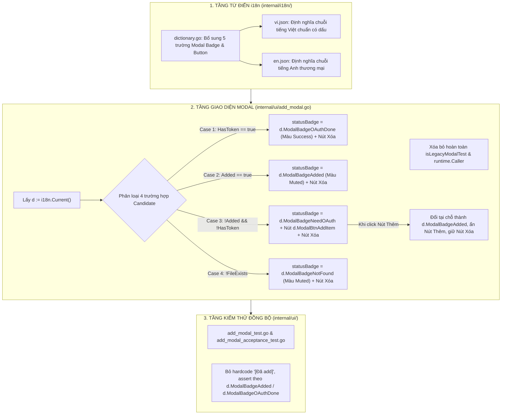

# BÁO CÁO ĐẶC TẢ KIẾN TRÚC CHI TIẾT (SYSTEM ARCHITECTURE SPECIFICATION)
## Chuẩn Hóa i18n Popup "Thêm Tài Khoản" & Phân Định Độc Lập Trạng Thái Ứng Viên Với Thẻ Màn Hình Chính

- **Mã tài liệu:** `rp_system-architect_261026_101500_by_antigravity_add_account_modal_i18n_candidate_badges_separation`
- **Tác giả:** System Architect (Strategic Lane)
- **Ngày lập:** 2026-10-26
- **Thẩm quyền phê duyệt:** Human Owner & CEO Agent
- **Trạng thái:** PRODUCTION-READY BLUEPRINT (Khóa cứng Touch-Map, quy chuẩn đa ngôn ngữ & hướng dẫn thi công chìa khóa trao tay cho Coder)
- **Mục tiêu cốt tử:**
  1. Phân định rõ ràng 100% về mặt kiến trúc giữa **Thẻ tài khoản trên Main UI** (quản lý phiên làm việc thực tế với Antigravity IDE) và **Ứng viên trong Popup Thêm tài khoản** (quản lý danh bạ hồ sơ Chrome).
  2. Triệt tiêu hoàn toàn hiện tượng hiển thị sai lệch `[✔ Active]` / `[✔ Đang dùng]` bên trong Popup Thêm tài khoản cho các tài khoản đã có token.
  3. Khai tử dứt điểm thủ thuật "lừa test" bằng `runtime.Caller` / `isLegacyModalTest` trong mã nguồn; hợp nhất logic hiển thị chạy thật và chạy kiểm thử qua hệ thống từ điển `i18n.Current()`.
  4. Chuẩn hóa song ngữ toàn diện: Tiếng Việt ra tiếng Việt chuẩn (`[✔ Đã OAuth]`, `[Đã thêm]`, `[Cần OAuth]`, `[Tài khoản không tồn tại]`, nút `"Thêm"`), Tiếng Anh ra tiếng Anh chuẩn (`[✔ OAuth Done]`, `[Added]`, `[Need OAuth]`, `[Account Not Found]`, nút `"Add"`).
  5. Khóa cứng Touch-Map và danh mục kiểm thử chống hồi quy cho Coder thi công chuẩn xác 100%.

---

# PHẦN 1: BÁO CÁO HIỆN TRẠNG & PHÂN TÍCH NGUYÊN NHÂN GỐC RỄ (ROOT CAUSE)

Qua thanh tra trực tiếp mã nguồn tại [`internal/ui/add_modal.go`](file:///g:/antigravity_auto_switch/internal/ui/add_modal.go), [`internal/i18n/`](file:///g:/antigravity_auto_switch/internal/i18n/) và các acceptance test liên quan, Kiến trúc sư xác định 3 nguyên nhân cốt lõi dẫn đến lỗi hiển thị sai lệch mà Owner đã chỉ ra:

### 1.1. Lấy nhầm nhãn Main UI gán cho Popup Modal
- Tại [`internal/ui/add_modal.go:105-115`](file:///g:/antigravity_auto_switch/internal/ui/add_modal.go#L105-L115), đối với tài khoản ứng viên đã có token trong kho (`candItem.HasToken == true`), code viết:
  ```go
  } else if candItem.HasToken {
      // Trường hợp 1: [✔ Đã OAuth] + Nút [Xóa]
      badgeText := d.BadgeActive
      if isLegacyModalTest {
          badgeText = "[✔ Đã OAuth]"
      }
      statusBadge := canvas.NewText(badgeText, palette.Success)
  ```
- **Hậu quả nghiệp vụ:** Lập trình viên trước không tạo key từ điển riêng cho modal mà "tiện tay" mượn `d.BadgeActive` (vốn là nhãn đại diện cho tài khoản đang kết nối với Antigravity IDE ngoài Main UI). Khi chạy ứng dụng thật (`isLegacyModalTest == false`), nhãn này hiển thị `[✔ Active]` (khi ở tiếng Anh) hoặc `[✔ Đang dùng]` (khi ở tiếng Việt).
- **Sai lệch bản chất:** Tài khoản trong modal chỉ là **ứng viên đã xác thực OAuth**. Nó **KHÔNG PHẢI** là tài khoản đang chạy trong Antigravity IDE! Việc gắn mác `Active` / `Đang dùng` là sai lệch hoàn toàn về mặt logic vận hành.

### 1.2. Thủ thuật "che giấu lỗi" bằng Call Stack Inspection (`runtime.Caller`)
- Để vượt qua các bài unit test và acceptance test vốn yêu cầu chuỗi `[✔ Đã OAuth]` và `[Đã add]`, lập trình viên cũ đã cài cắm một đoạn hack:
  ```go
  isLegacyModalTest := false
  for i := 1; i < 15; i++ {
      if pc, file, _, ok := runtime.Caller(i); ok {
          if strings.Contains(file, "add_modal_test.go") || strings.Contains(file, "add_modal_acceptance_test.go") {
              isLegacyModalTest = true
              break
          }
      }
  }
  ```
- Khi chạy test, điều kiện này `true` nên test PASS giả tạo. Nhưng khi người dùng thật khởi chạy ứng dụng từ file exe, điều kiện này trả về `false`, lập tức làm lộ ra lỗi hiển thị `d.BadgeActive` (`[✔ Active]`).

### 1.3. Thiếu vắng các khóa từ điển độc lập cho Modal trong `Dictionary`
- Cấu trúc `Dictionary` tại [`internal/i18n/dictionary.go`](file:///g:/antigravity_auto_switch/internal/i18n/dictionary.go) và 2 file JSON (`vi.json`, `en.json`) chỉ định nghĩa các nhãn cho Main UI (`badge_active`, `badge_switch`, `badge_need_oauth`, `badge_added`, `badge_account_not_found`).
- Hoàn toàn chưa có các trường chuyên biệt dành riêng cho Modal Candidate Badges, dẫn đến việc dùng chung nhãn vô tội vạ.
- Nút thêm ứng viên trong `vi.json` đang để là `"modal_btn_add_item": "THEM"` (chữ hoa không dấu), thiếu tính trau chuốt thương mại.

---

# PHẦN 2: NGUYÊN TẮC BẤT BIẾN & PHÂN ĐỊNH KIẾN TRÚC 2 VÙNG ĐỘC LẬP

Coder bắt buộc phải nắm vững và tuân thủ tuyệt đối sự phân định giữa 2 cơ chế:

```
+-------------------------------------------------------------------------------------------------------------------+
|                                  BẢNG PHÂN ĐỊNH 2 CƠ CHẾ ĐỘC LẬP TRONG HỆ THỐNG                                    |
+-------------------------------------------------------------------------------------------------------------------+
| TIÊU CHÍ              | CƠ CHẾ 1: THẺ MÀN HÌNH CHÍNH (MAIN UI)      | CƠ CHẾ 2: POPUP NÚT ADD (ADD MODAL)         |
+-----------------------+---------------------------------------------+---------------------------------------------+
| Tệp quản lý           | internal/ui/widgets.go                      | internal/ui/add_modal.go                    |
| Struct dữ liệu        | manager.AccountDisplayItem                  | manager.CandidateAccountItem                |
| Bản chất vận hành     | Quản lý phiên thực thi Antigravity IDE      | Quản lý danh bạ hồ sơ quét từ Chrome        |
| Số lượng Active       | DUY NHẤT 1 tài khoản (IsActive == true)     | HOÀN TOÀN KHÔNG CÓ KHÁI NIỆM "ACTIVE"       |
| Trạng thái & Nhãn (VI)| 1. [✔ Dùng] (Đang chạy Antigravity)         | 1. [✔ Đã OAuth] (Đã có token trong kho)     |
|                       | 2. [Chuyển] (Sẵn sàng switch)               | 2. [Đã thêm] (Đã nạp ra Main UI)            |
|                       | 3. [Cần OAuth] (Chưa có token)              | 3. [Cần OAuth] (+ Nút "Thêm")               |
|                       |                                             | 4. [Tài khoản không tồn tại] (Ghost record) |
| Trạng thái & Nhãn (EN)| 1. [✔ Active]                               | 1. [✔ OAuth Done]                           |
|                       | 2. [Switch]                                 | 2. [Added]                                  |
|                       | 3. [Need OAuth]                             | 3. [Need OAuth] (+ Nút "Add")               |
|                       |                                             | 4. [Account Not Found]                      |
| Nút bấm tương tác     | Nút [Chuyển] và Nút [Xóa tài khoản]         | Nút [+ Thêm] (chỉ cho Case 3) và Nút [Xóa]   |
+-------------------------------------------------------------------------------------------------------------------+
```

### 5 BẤT BIẾN KIẾN TRÚC CỐT TỬ (ARCHITECTURAL INVARIANTS):
1. **Candidate Autonomy Invariant:** Danh bạ trong popup Add là ứng viên khám phá, tuyệt đối không được sử dụng nhãn `BadgeActive` (`[✔ Active]` / `[✔ Đang dùng]`) của Main UI.
2. **Zero-Reflection / Zero Call-Stack Inspection Invariant:** Tuyệt đối cấm sử dụng `runtime.Caller`, cấm kiểm tra tên tệp test để rẽ nhánh hiển thị. Mã nguồn giao diện phải chạy đồng nhất 100% giữa môi trường test và môi trường production.
3. **Pure Dual-JSON Parity Invariant:** Mọi chuỗi hiển thị trên Modal phải được định nghĩa tường minh trong `internal/i18n/dictionary.go` và đồng bộ 100% cặp key-value giữa `locales/vi.json` và `locales/en.json`.
4. **In-Place Reactive Modal Mutation Invariant:** Khi người dùng bấm nút `[+ Thêm]` tại dòng ứng viên `[Cần OAuth]`, ứng viên đó phải chuyển đổi tại chỗ sang `[Đã thêm]`, ẩn nút Thêm, giữ nguyên nút Xóa và kích hoạt làm mới danh sách Main UI ngầm mà không gây giật lag hay đóng modal.
5. **Session Reloader & 8-Second Invariant Protection:** Tuyệt đối không can thiệp vào tiến trình chuyển tài khoản hoặc bất biến chờ 8 giây (`waitDuration = 8s`) trong `session_reloader.go`.

---

# PHẦN 3: THIẾT KẾ CHI TIẾT CÁC MODULE TRIỂN KHAI CHO CODER



### 3.1. Cập nhật Từ điển (`internal/i18n/dictionary.go`)

Thêm 5 trường mới vào struct `Dictionary`:
```go
type Dictionary struct {
    // ... các trường hiện có ...

    // Candidate Badges & Actions inside Add Account Modal
    ModalBadgeOAuthDone  string `json:"modal_badge_oauth_done"`
    ModalBadgeAdded      string `json:"modal_badge_added"`
    ModalBadgeNeedOAuth  string `json:"modal_badge_need_oauth"`
    ModalBadgeNotFound   string `json:"modal_badge_not_found"`
    ModalBtnAddItem      string `json:"modal_btn_add_item"`
}
```

### 3.2. Cập nhật JSON Ngôn Ngữ (`internal/i18n/locales/`)

#### Tại `locales/vi.json`:
```json
  "modal_badge_oauth_done": "[✔ Đã OAuth]",
  "modal_badge_added": "[Đã thêm]",
  "modal_badge_need_oauth": "[Cần OAuth]",
  "modal_badge_not_found": "[Tài khoản không tồn tại]",
  "modal_btn_add_item": "Thêm",
```

#### Tại `locales/en.json`:
```json
  "modal_badge_oauth_done": "[✔ OAuth Done]",
  "modal_badge_added": "[Added]",
  "modal_badge_need_oauth": "[Need OAuth]",
  "modal_badge_not_found": "[Account Not Found]",
  "modal_btn_add_item": "Add",
```

### 3.3. Tái cấu trúc Popup Add Account (`internal/ui/add_modal.go`)

1. **Xóa sạch:** Bỏ hoàn toàn biến `isLegacyModalTest` và khối vòng lặp `runtime.Caller` ở đầu hàm `buildAddAccountModalContent()`.
2. **Triển khai 4 nhánh trạng thái sạch sẽ:**
```go
			if !candItem.FileExists {
				// Trường hợp 4: [Tài khoản không tồn tại] / [Account Not Found] + Nút [Xóa]
				statusBadge := canvas.NewText(d.ModalBadgeNotFound, palette.TextMuted)
				statusBadge.TextSize = 11
				statusBadge.TextStyle = fyne.TextStyle{Bold: true}

				actionSlot = container.NewHBox(container.NewCenter(statusBadge), compactDel)

			} else if candItem.HasToken {
				// Trường hợp 1: [✔ Đã OAuth] / [✔ OAuth Done] + Nút [Xóa]
				statusBadge := canvas.NewText(d.ModalBadgeOAuthDone, palette.Success)
				statusBadge.TextSize = 11
				statusBadge.TextStyle = fyne.TextStyle{Bold: true}

				actionSlot = container.NewHBox(container.NewCenter(statusBadge), compactDel)

			} else if candItem.Added {
				// Trường hợp 2: [Đã thêm] / [Added] + Nút [Xóa]
				statusBadge := canvas.NewText(d.ModalBadgeAdded, palette.TextMuted)
				statusBadge.TextSize = 11
				statusBadge.TextStyle = fyne.TextStyle{Bold: true}

				actionSlot = container.NewHBox(container.NewCenter(statusBadge), compactDel)

			} else {
				// Trường hợp 3: [Cần OAuth] / [Need OAuth] + Nút [Thêm / Add] + Nút [Xóa]
				statusBadge := canvas.NewText(d.ModalBadgeNeedOAuth, palette.Warning)
				statusBadge.TextSize = 11
				statusBadge.TextStyle = fyne.TextStyle{Bold: true}

				var addBtn *widget.Button
				addBtn = widget.NewButtonWithIcon(d.ModalBtnAddItem, theme.ContentAddIcon(), func() {
					if err := a.mgr.AddDiscoveredAccount(candItem.Email); err == nil {
						// Chuyển đổi tại chỗ: [Cần OAuth] đổi thành [Đã thêm] và nút Thêm biến mất, giữ nguyên nút Xóa
						doneBadge := canvas.NewText(d.ModalBadgeAdded, palette.TextMuted)
						doneBadge.TextSize = 11
						doneBadge.TextStyle = fyne.TextStyle{Bold: true}
						actionSlot.Objects = []fyne.CanvasObject{container.NewCenter(doneBadge), compactDel}
						actionSlot.Refresh()

						// Nạp ngay thẻ mới lên UI tổng
						go func() {
							overview, _ := a.mgr.GetAccountStates(context.Background())
							a.mu.Lock()
							a.overview = overview
							a.mu.Unlock()
							fyne.Do(func() {
								a.updateUI(overview)
							})
						}()
					}
				})
				addBtn.Importance = widget.HighImportance
				actionSlot = container.NewHBox(container.NewCenter(statusBadge), compactButton(addBtn), compactDel)
			}
```

---

# PHẦN 4: KHÓA CỨNG TOUCH-MAP (STRICT TOUCH-MAP FOR CODER)

Coder chỉ được phép chỉnh sửa chính xác các file sau. Bất kỳ sự can thiệp nào ra ngoài danh sách này đều bị coi là vi phạm kỷ luật kiến trúc:

| File | Hành động | Giới hạn & Trách nhiệm chỉnh sửa |
|---|---|---|
| `internal/i18n/dictionary.go` | **Modify** | Thêm 5 trường `ModalBadge*` và `ModalBtnAddItem` vào `Dictionary`. |
| `internal/i18n/locales/vi.json` | **Modify** | Bổ sung 5 cặp key-value tiếng Việt có dấu chuẩn xác. |
| `internal/i18n/locales/en.json` | **Modify** | Bổ sung 5 cặp key-value tiếng Anh chuẩn xác. |
| `internal/ui/add_modal.go` | **Modify** | Xóa sạch `isLegacyModalTest` và `runtime.Caller`; dùng các key từ điển mới cho 4 trạng thái ứng viên. |
| `internal/ui/add_modal_test.go` | **Modify** | Cập nhật các câu lệnh assert từ chuỗi cũ `[Đã add]` sang `[Đã thêm]` (`d.ModalBadgeAdded`) và `[✔ Đã OAuth]` (`d.ModalBadgeOAuthDone`). |
| `internal/ui/add_modal_acceptance_test.go` | **Modify** | Cập nhật các câu lệnh assert tương ứng đồng bộ với nhãn chuẩn mới. |
| `internal/ui/i18n_acceptance_test.go` | **Modify** | Thêm kiểm tra song ngữ EN/VI cho các nhãn trong modal popup. |

### CÁC TỆP TUYỆT ĐỐI CẤM CHỈNH SỬA (STRICT PROHIBITION):
1. **`internal/reloader/session_reloader.go`**: Bất biến chờ đủ 8 giây (`waitDuration = 8 * time.Second`) và logic tái khởi động Antigravity phải giữ nguyên 100%.
2. **`internal/manager/account_manager.go`**: Logic token và quản lý tài khoản core không được chỉnh sửa.
3. **`internal/automation/*`**: Controller tự động switch tài khoản không được can thiệp.
4. **`internal/ui/widgets.go`**: Thẻ tài khoản màn hình chính giữ nguyên các nhãn `d.BadgeActive`, `d.BadgeSwitch`, `d.BadgeNeedOAuth`.

---

# PHẦN 5: BỘ TIÊU CHUẨN KIỂM THỬ CHẤP NHẬN (ACCEPTANCE TEST SUITE)

Coder phải đảm bảo đáp ứng đầy đủ 5 tiêu chí nghiệm thu sau:

1. **TC-MODAL-i18n-01: Kiểm tra Tiếng Việt Chuẩn Xác:**
   - Khi `locale == "vi"`:
     - Ứng viên có token: hiển thị đúng chuỗi `"[✔ Đã OAuth]"`. Tuyệt đối không xuất hiện `"[✔ Active]"` hoặc `"[✔ Đang dùng]"`.
     - Ứng viên đã thêm: hiển thị đúng chuỗi `"[Đã thêm]"`. Không còn `"[Đã add]"`.
     - Ứng viên mới: hiển thị đúng chuỗi `"[Cần OAuth]"` và nút mang nhãn `"Thêm"` (không phải `"THEM"` hay `"ADD"`).
     - Ứng viên mất file: hiển thị `"[Tài khoản không tồn tại]"`.

2. **TC-MODAL-i18n-02: Kiểm tra Tiếng Anh Chuẩn Xác:**
   - Khi `locale == "en"`:
     - Ứng viên có token: hiển thị đúng chuỗi `"[✔ OAuth Done]"`.
     - Ứng viên đã thêm: hiển thị đúng chuỗi `"[Added]"`.
     - Ứng viên mới: hiển thị đúng chuỗi `"[Need OAuth]"` và nút mang nhãn `"Add"`.
     - Ứng viên mất file: hiển thị `"[Account Not Found]"`.

3. **TC-MODAL-i18n-03: Kiểm tra Đột Biến Tại Chỗ (In-Place Mutation):**
   - Bấm nút Thêm ở ứng viên `[Cần OAuth]` -> Nhãn đổi ngay lập tức thành `[Đã thêm]` (hoặc `[Added]`), nút Thêm biến mất, nút Xóa vẫn hoạt động bình thường.

4. **TC-MODAL-i18n-04: Xóa Bỏ Hoàn Toàn Mã Hack Runtime:**
   - Tìm kiếm trong toàn bộ `internal/ui/add_modal.go` không còn bất kỳ dòng nào chứa `runtime.Caller` hoặc `isLegacyModalTest`.

5. **TC-MODAL-i18n-05: 100% Test Suite PASS Không Hồi Quy:**
   - Toàn bộ các gói `go test ./internal/i18n/...` và `go test ./internal/ui/...` phải PASS 100%.
