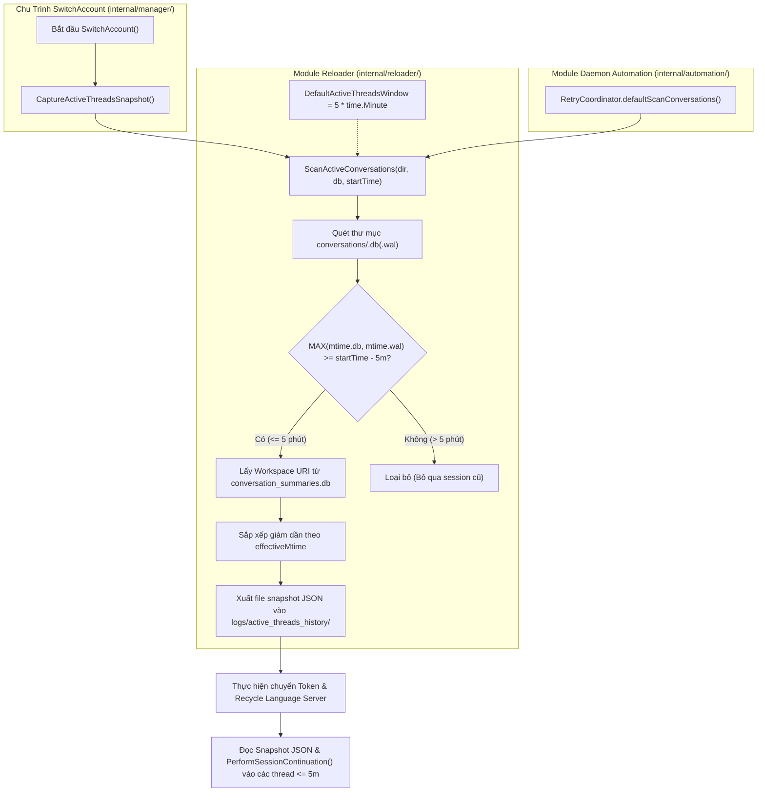

# BÁO CÁO ĐẶC TẢ KIẾN TRÚC CHI TIẾT (SYSTEM ARCHITECTURE SPECIFICATION)
## Chuẩn Hóa Cửa Sổ Quét Session Active 5 Phút & Tái Cấu Trúc Hàm ScanActiveConversations (Zero-Legacy Clean Cut)

- **Mã tài liệu:** `rp_system-architect_261028_123500_by_antigravity_active_conversations_window_5m_refactor`
- **Tác giả:** System Architect (Strategic Lane)
- **Ngày lập:** 2026-10-28
- **Thẩm quyền phê duyệt:** Human Owner (Chủ tịch) đã phê duyệt trực tiếp
- **Trạng thái:** PRODUCTION-READY BLUEPRINT (Khóa cứng Touch-Map, hợp đồng kiến trúc & bàn giao chìa khóa trao tay cho Coder)
- **Mục tiêu cốt tử:**
  1. **Rút ngắn cửa sổ lọc active session từ 2 giờ xuống 5 phút gần nhất:** Chỉ những session thực sự đang làm việc trong 5 phút gần đây mới được kích hoạt lại prompt tiếp tục (`PerformSessionContinuation`). Triệt tiêu hoàn toàn rủi ro gửi thông điệp vào các session cũ người dùng đã hoàn tất công việc.
  2. **Chuẩn hóa định danh hàm (Contract Normalization):** Khai tử tên hàm gắn cứng số giờ `ScanActiveConversations2h`, đổi thành tên chuẩn mực kiến trúc `ScanActiveConversations`.
  3. **Loại bỏ Magic Number:** Khai báo hằng số chuẩn `DefaultActiveThreadsWindow = 5 * time.Minute` tại package `reloader`.
  4. **Thực thi nguyên tắc Clean-Cut (Zero-Legacy):** Theo chỉ thị tối cao từ Chủ tịch, **tuyệt đối không tạo alias / wrapper tương thích ngược** `ScanActiveConversations2h`. Dọn sạch 100% tàn dư kỹ thuật cũ.
  5. **Đồng bộ hóa Callers & Test Suite:** Cập nhật đồng bộ các điểm gọi hàm trong `internal/automation/retry.go`, `internal/manager/account_manager.go` và toàn bộ các test case trong `internal/reloader/active_threads_test.go` đạt 100% PASS.

---

# PHẦN 1: BỐI CẢNH & PHÂN TÍCH KIẾN TRÚC

### 1.1. Hiện trạng cơ chế cũ
Trong chu trình chuyển đổi tài khoản ([`SwitchAccount`](file:///g:/antigravity_auto_switch/internal/manager/account_manager.go#L714)), hệ thống tiến hành đóng băng danh sách các phiên làm việc (Snapshot SQLite) trước khi tái kích hoạt Language Server:
- Hàm thực thi: `ScanActiveConversations2h` tại [`internal/reloader/active_threads.go:58`](file:///g:/antigravity_auto_switch/internal/reloader/active_threads.go#L58).
- Ngưỡng lọc cũ: `threshold := startTime.Add(-2 * time.Hour)`.
- Nhược điểm: Ngưỡng 2 giờ là quá rộng đối với thực tế phát triển phần mềm hàng ngày. Nhiều session người dùng đã xong việc hoặc đã đóng từ 1-2 tiếng trước vẫn bị quét và tự động gửi prompt tiếp tục phiên (`"Continue if you still have unfinished work in progress..."`), gây gián đoạn và phiền hà cho người dùng.

### 1.2. Quyết định Kiến trúc của Chủ tịch (Owner Mandate)
- **Thời gian cửa sổ mới:** Đúng **5 phút** (`5 * time.Minute`).
- **Tên hàm:** Đổi thành **`ScanActiveConversations`** (bỏ đuôi `2h`).
- **Quy tắc chuyển dịch:** **Không dùng alias** tương thích ngược. Thay thế triệt để, đồng bộ và dứt điểm trên toàn bộ mã nguồn.

---

# PHẦN 2: NGUYÊN TẮC BẤT BIẾN KIẾN TRÚC (ARCHITECTURAL INVARIANTS)

Coder khi triển khai bắt buộc phải tuân thủ nghiêm ngặt 5 bất biến sau:

1. **Zero-Legacy / No-Alias Invariant:** Tuyệt đối cấm tạo hàm wrapper kiểu `ScanActiveConversations2h(...)`. Tên `ScanActiveConversations2h` phải được xóa bỏ 100% khỏi codebase sản phẩm và test.
2. **Explicit Constant Invariant:** Giá trị `5 * time.Minute` phải được định nghĩa bằng hằng số `DefaultActiveThreadsWindow` có phạm vi export cấp package `reloader`, không được hardcode trực tiếp dạng magic number bên trong logic hàm.
3. **Effective Mtime Parity Invariant:** Giữ nguyên 100% logic xác định thời gian cập nhật của SQLite: `effectiveMtime = MAX(mtime(.db), mtime(.db-wal))`. Bất kỳ thread nào có `effectiveMtime.Before(threshold)` đều bị loại trừ.
4. **UUID Strict Validation Invariant:** Tiếp tục bắt buộc tên file SQLite basename phải khớp hoàn toàn biểu thức chính quy UUID v4/standard `reUUID`. Bỏ qua các file rác như `conversation_summaries.db`, `index.db`...
5. **Caller & Test Completeness Invariant:** Mọi vị trí gọi hàm bên ngoài package `reloader` (`internal/automation/retry.go`) và toàn bộ test suite phải chuyển đổi đồng bộ sang `ScanActiveConversations`, kiểm thử đạt `PASS` tuyệt đối.

---

# PHẦN 3: SƠ ĐỒ LUỒNG DỮ LIỆU & KIẾN TRÚC THỰC THI



---

# PHẦN 4: HƯỚNG DẪN THI CÔNG CHI TIẾT DÀNH CHO CODER (TOUCH-MAP)

### 4.1. Tệp 1: [`internal/reloader/active_threads.go`](file:///g:/antigravity_auto_switch/internal/reloader/active_threads.go)

#### A. Khai báo hằng số:
Thêm hằng số `DefaultActiveThreadsWindow` cạnh `DefaultHistoryKeepCount`:
```go
// DefaultHistoryKeepCount defines the maximum number of active threads snapshot files retained.
const DefaultHistoryKeepCount = 2

// DefaultActiveThreadsWindow defines the time window for detecting active conversation threads.
const DefaultActiveThreadsWindow = 5 * time.Minute
```

#### B. Đổi tên hàm & Ngưỡng thời gian:
Thay thế hoàn toàn hàm `ScanActiveConversations2h`:
```go
// ScanActiveConversations scans %USERPROFILE%/.gemini/antigravity/conversations/
// for all threads with MAX(mtime(.db), mtime(.db-wal)) >= startTime - DefaultActiveThreadsWindow.
// It strictly requires basenames to be valid UUIDs (F3).
func ScanActiveConversations(conversationsDir string, summariesDbPath string, startTime time.Time) ([]ActiveThread, error) {
	cDir := conversationsDir
	if cDir == "" {
		home, _ := os.UserHomeDir()
		if home == "" {
			home = os.Getenv("USERPROFILE")
		}
		if home != "" {
			cDir = filepath.Join(home, ".gemini", "antigravity", "conversations")
		}
	}

	threshold := startTime.Add(-DefaultActiveThreadsWindow)
    ...
```

#### C. Cập nhật hàm gọi nội bộ:
Tại hàm `defaultCaptureActiveThreadsSnapshot` (dòng 204):
```go
func defaultCaptureActiveThreadsSnapshot(conversationsDir, summariesDbPath, outputDir string) (string, []ActiveThread, error) {
	start := time.Now()
	activeThreads, err := ScanActiveConversations(conversationsDir, summariesDbPath, start)
	if err != nil {
		return "", nil, err
	}
    ...
```
Cập nhật comment tại dòng 199-201: thay `start - 2h` thành `start - DefaultActiveThreadsWindow (5m)`.

---

### 4.2. Tệp 2: [`internal/automation/retry.go`](file:///g:/antigravity_auto_switch/internal/automation/retry.go)

Tại phương thức `defaultScanConversations` (dòng 70):
```go
func (rc *RetryCoordinator) defaultScanConversations(ctx context.Context) ([]string, error) {
	if err := ctx.Err(); err != nil {
		return nil, err
	}
	threads, err := reloader.ScanActiveConversations("", "", time.Now())
	if err != nil {
		return nil, err
	}
	ids := make([]string, 0, len(threads))
	for _, t := range threads {
		if t.ThreadID != "" {
			ids = append(ids, t.ThreadID)
		}
	}
	return ids, nil
}
```

---

### 4.3. Tệp 3: [`internal/manager/account_manager.go`](file:///g:/antigravity_auto_switch/internal/manager/account_manager.go)

Tại dòng 712: Cập nhật comment tài liệu bước thực thi:
```go
	// =========================================================================
	// BƯỚC 1: Chốt danh sách trước khi chuyển tài khoản (Snapshot SQLite 5 Phút)
	// =========================================================================
```

---

### 4.4. Tệp 4: [`internal/reloader/active_threads_test.go`](file:///g:/antigravity_auto_switch/internal/reloader/active_threads_test.go)

Cần cập nhật 2 test case:

#### A. Cập nhật `TestScanActiveConversations_ThresholdFiltering`:
Đổi tên test `TestScanActiveConversations2h_ThresholdFiltering` $\rightarrow$ `TestScanActiveConversations_ThresholdFiltering`.
Thiết lập lại các mốc mock mtime cho đúng ngưỡng 5 phút:
```go
func TestScanActiveConversations_ThresholdFiltering(t *testing.T) {
	tmpDir := t.TempDir()
	now := time.Now()

	// Thread A: valid UUID, mtime = now - 1m -> should be included (< 5m)
	idA := "11111111-1111-4111-8111-111111111111"
	fileA := filepath.Join(tmpDir, idA+".db")
	if err := os.WriteFile(fileA, []byte("data-a"), 0644); err != nil {
		t.Fatalf("failed writing fileA: %v", err)
	}
	_ = os.Chtimes(fileA, now.Add(-1*time.Minute), now.Add(-1*time.Minute))

	// Thread B: valid UUID, mtime = now - 3m -> should be included (< 5m)
	idB := "22222222-2222-4222-8222-222222222222"
	fileB := filepath.Join(tmpDir, idB+".db")
	if err := os.WriteFile(fileB, []byte("data-b"), 0644); err != nil {
		t.Fatalf("failed writing fileB: %v", err)
	}
	_ = os.Chtimes(fileB, now.Add(-3*time.Minute), now.Add(-3*time.Minute))

	// Thread C: valid UUID, .db mtime = now - 10m, but .db-wal mtime = now - 30s -> should be included (MAX logic, newest)
	idC := "33333333-3333-4333-8333-333333333333"
	fileC := filepath.Join(tmpDir, idC+".db")
	fileCWal := filepath.Join(tmpDir, idC+".db-wal")
	if err := os.WriteFile(fileC, []byte("data-c"), 0644); err != nil {
		t.Fatalf("failed writing fileC: %v", err)
	}
	_ = os.Chtimes(fileC, now.Add(-10*time.Minute), now.Add(-10*time.Minute))
	if err := os.WriteFile(fileCWal, []byte("wal-c"), 0644); err != nil {
		t.Fatalf("failed writing fileCWal: %v", err)
	}
	_ = os.Chtimes(fileCWal, now.Add(-30*time.Second), now.Add(-30*time.Second))

	// Thread D: valid UUID, mtime = now - 6m -> should be excluded (> 5m)
	idD := "44444444-4444-4444-8444-444444444444"
	fileD := filepath.Join(tmpDir, idD+".db")
	if err := os.WriteFile(fileD, []byte("data-d"), 0644); err != nil {
		t.Fatalf("failed writing fileD: %v", err)
	}
	_ = os.Chtimes(fileD, now.Add(-6*time.Minute), now.Add(-6*time.Minute))

	// F3: Non-UUID databases must be strictly rejected
	fileIndex := filepath.Join(tmpDir, "index.db")
	_ = os.WriteFile(fileIndex, []byte("index-data"), 0644)
	_ = os.Chtimes(fileIndex, now, now)

	fileBackup := filepath.Join(tmpDir, "backup-copy.db-wal")
	_ = os.WriteFile(fileBackup, []byte("backup-wal"), 0644)
	_ = os.Chtimes(fileBackup, now, now)

	fileSummaries := filepath.Join(tmpDir, "conversation_summaries.db")
	_ = os.WriteFile(fileSummaries, []byte("summary"), 0644)
	_ = os.Chtimes(fileSummaries, now, now)

	activeThreads, err := ScanActiveConversations(tmpDir, "", now)
	if err != nil {
		t.Fatalf("ScanActiveConversations failed: %v", err)
	}

	if len(activeThreads) != 3 {
		t.Fatalf("Expected exactly 3 active threads, got %d: %+v", len(activeThreads), activeThreads)
	}

	// Ordering must be descending by effectiveMtime:
	// 1st: thread-c (effective = now - 30s)
	// 2nd: thread-a (effective = now - 1m)
	// 3rd: thread-b (effective = now - 3m)
	if activeThreads[0].ThreadID != idC {
		t.Errorf("Expected 1st thread to be %s, got %s", idC, activeThreads[0].ThreadID)
	}
	if !activeThreads[0].IsMainPane {
		t.Errorf("Expected 1st thread to have IsMainPane = true")
	}
	if activeThreads[1].ThreadID != idA {
		t.Errorf("Expected 2nd thread to be %s, got %s", idA, activeThreads[1].ThreadID)
	}
	if activeThreads[2].ThreadID != idB {
		t.Errorf("Expected 3rd thread to be %s, got %s", idB, activeThreads[2].ThreadID)
	}
}
```

#### B. Cập nhật `TestCaptureActiveThreadsSnapshot_SQLite`:
Tại dòng 155, điều chỉnh mtime của `f1`:
```go
	// Thay:
	_ = os.Chtimes(f1, now.Add(-5*time.Minute), now.Add(-5*time.Minute))
	// Thành:
	_ = os.Chtimes(f1, now.Add(-2*time.Minute), now.Add(-2*time.Minute))
```
*(Lý do: Ngưỡng lọc là đúng 5 phút. Nếu đặt mock đúng 5 phút tròn, do sai lệch vài mili-giây khi hàm `CaptureActiveThreadsSnapshot` gọi `time.Now()`, file có thể bị rơi vào vùng `effective.Before(threshold)`. Chuyển sang `-2*time.Minute` giúp test ổn định 100%).*

---

# PHẦN 5: MA TRẬN BẢO ĐẢM CHẤT LƯỢNG (VERIFICATION GATES)

Coder sau khi hoàn thành bắt buộc phải chạy lệnh kiểm thử toàn diện:

```powershell
go test -v ./internal/reloader/...
go test -v ./internal/automation/...
go test -v ./internal/manager/...
```

**Tiêu chí nghiệm thu (Pass Criteria):**
1. 100% test cases trong `./internal/reloader/...` đều `PASS`.
2. Kiểm tra `git grep -n "ScanActiveConversations2h"` trả về rỗng (0 kết quả trong mã nguồn và test).
3. Ứng dụng build thành công không có bất kỳ warning hay compile error nào.

---

# PHẦN 6: KẾT LUẬN & ĐỀ NGHỊ BÀN GIAO CHO CODER

Tài liệu đặc tả kiến trúc này đã khóa cứng mọi chi tiết kỹ thuật từ hằng số, tên hàm, điểm gọi, đến ma trận dữ liệu test. 

Kính đề nghị **CEO Agent** tiếp nhận báo cáo và kích hoạt nhánh **Coder** triển khai chính xác theo đúng Touch-Map trên!
