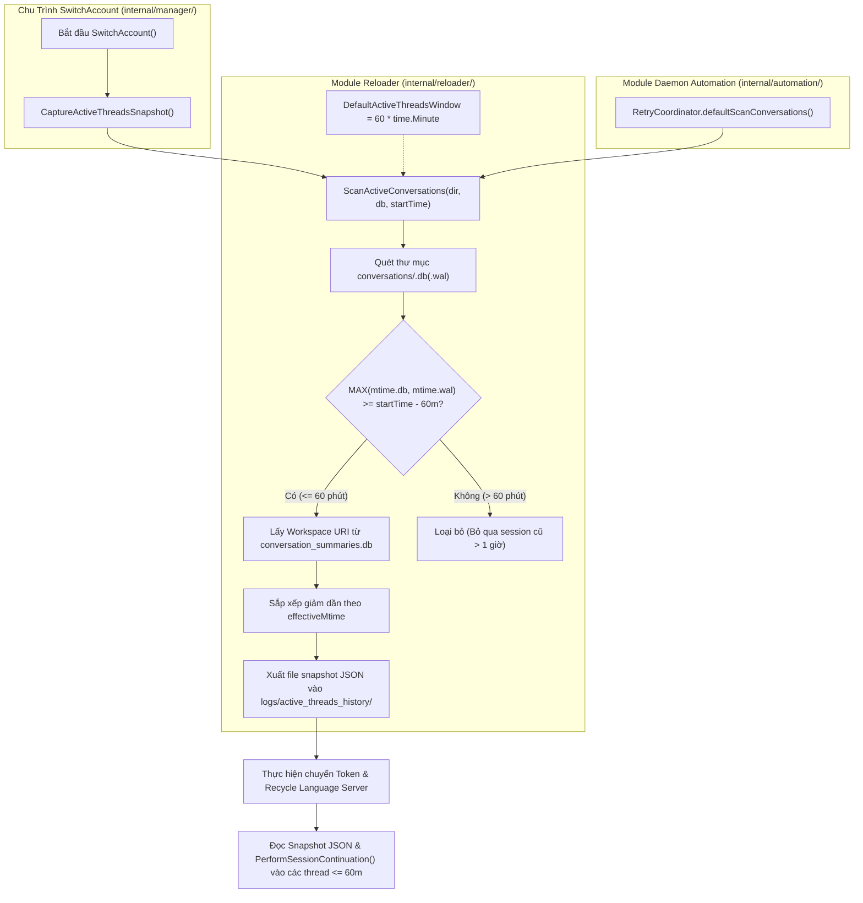

# BÁO CÁO ĐẶC TẢ KIẾN TRÚC CHI TIẾT (SYSTEM ARCHITECTURE SPECIFICATION)
## Mở Rộng Cửa Sổ Quét Active Conversation Threads Lên 60 Phút (1 Giờ) Trong Chu Trình Đổi Tài Khoản & Tái Kích Hoạt Phiên

- **Mã tài liệu:** `rp_system-architect_261028_203500_by_antigravity_active_conversations_window_60m`
- **Tác giả:** System Architect (Strategic Lane)
- **Ngày lập:** 2026-10-28
- **Thẩm quyền phê duyệt:** Human Owner (Chủ tịch) phê duyệt trực tiếp
- **Trạng thái:** PRODUCTION-READY BLUEPRINT (Đóng băng đặc tả kiến trúc, sẵn sàng kích hoạt thực thi)
- **Điều kiện tiên quyết kích hoạt (Activation Gate):** Chỉ cho phép CEO phân phối nhiệm vụ cho Coder/QA triển khai sau khi vấn đề đang triển khai trong codebase (Phase 1: Auto Switcher sidebar with dedicated Antigravity tab) hoàn thành và đạt PASS 100% nghiệm thu.

---

# PHẦN 1: BỐI CẢNH & YÊU CẦU CHIẾN LƯỢC CỦA CHỦ TỊCH

### 1.1. Bối cảnh bài toán
Trong chu trình chuyển đổi tài khoản ([`SwitchAccount`](file:///g:/antigravity_auto_switch/internal/manager/account_manager.go#L714)), hệ thống tiến hành đóng băng danh sách các phiên làm việc (Snapshot SQLite) trước khi tái kích hoạt Language Server để gửi prompt tiếp tục phiên (`PerformSessionContinuation`):
- Cửa sổ lọc hiện tại: `DefaultActiveThreadsWindow = 5 * time.Minute`.
- Nhược điểm thực tế: Trong quy trình lập trình thực tế, người dùng thường có các quãng nghỉ ngắn, đọc tài liệu, kiểm thử thủ công hoặc thảo luận kỹ thuật kéo dài từ 10 đến 45 phút giữa các câu lệnh. Với ngưỡng 5 phút, các phiên làm việc đang dở dang này bị loại khỏi snapshot và không nhận được prompt tiếp tục tự động sau khi đổi tài khoản.

### 1.2. Chỉ đạo chiến lược của Chủ tịch (Human Owner Mandate)
1. **Nâng ngưỡng thời gian lọc session active:** Mở rộng từ **5 phút lên đúng 60 phút (1 giờ)** (`60 * time.Minute`). Đảm bảo toàn bộ các session có tương tác trong vòng 1 giờ qua đều được phát hiện và gửi prompt kích hoạt làm việc lại một cách thông suốt.
2. **Kế thừa kiến trúc chuẩn (Zero-Magic-Number):** Tận dụng kiến trúc hằng số đã được chuẩn hóa `DefaultActiveThreadsWindow`, thay đổi giá trị tập trung tại một vị trí duy nhất, đảm bảo tính nhất quán trên toàn bộ codebase.
3. **Thứ tự thực thi nghiêm ngặt (Sequential Deployment Order):**
   > *"Yêu cầu khi vấn đề đang triển khai trong codebase pass hoàn toàn thì cho triển khai báo cáo này."*
   
   Báo cáo đặc tả này được bàn giao cho CEO ở trạng thái sẵn sàng (Ready-to-Deploy). CEO chỉ được điều động Coder và QA thực hiện việc nâng ngưỡng lên 60 phút sau khi Phase 1 (Sidebar Auto Switcher) đã được kiểm thử và nghiệm thu PASS toàn diện.

---

# PHẦN 2: NGUYÊN TẮC BẤT BIẾN KIẾN TRÚC (ARCHITECTURAL INVARIANTS)

Coder và QA khi thực hiện bắt buộc phải tuân thủ nghiêm ngặt 5 nguyên tắc bất biến sau:

1. **Constant Single-Source-of-Truth Invariant:** Giá trị `60 * time.Minute` (hoặc `1 * time.Hour`) phải được khai báo duy nhất qua hằng số `DefaultActiveThreadsWindow` có phạm vi export cấp package `reloader` tại [`internal/reloader/active_threads.go`](file:///g:/antigravity_auto_switch/internal/reloader/active_threads.go#L39). Tuyệt đối cấm hardcode con số `60m` trực tiếp dạng magic number trong thân hàm.
2. **Contract Signature Stability Invariant:** Không thay đổi định danh hàm hay chữ ký hàm `ScanActiveConversations(conversationsDir string, summariesDbPath string, startTime time.Time) ([]ActiveThread, error)`. Tất cả các hàm gọi từ bên ngoài (`internal/automation/retry.go`, `internal/reloader/active_threads.go`) không phải sửa lại interface.
3. **Effective Mtime Parity Invariant:** Giữ nguyên 100% logic SQLite: `effectiveMtime = MAX(mtime(.db), mtime(.db-wal))`. Bất kỳ thread nào có `effectiveMtime.Before(startTime.Add(-DefaultActiveThreadsWindow))` đều bị loại trừ.
4. **UUID Strict Validation Invariant:** Tiếp tục bắt buộc tên file SQLite basename phải khớp hoàn toàn biểu thức chính quy UUID v4/standard `reUUID`. Bỏ qua các file hệ thống khác như `conversation_summaries.db`, `index.db`...
5. **Test Boundary Alignment Invariant:** Test case `TestScanActiveConversations_ThresholdFiltering` trong [`internal/reloader/active_threads_test.go`](file:///g:/antigravity_auto_switch/internal/reloader/active_threads_test.go) phải cập nhật mốc thời gian của `Thread D` từ `now - 6m` thành `now - 65m` (hoặc `now - 70m`). Đảm bảo kiểm tra chính xác ranh giới loại trừ ngoài 60 phút, kiểm thử đạt 100% PASS.

---

# PHẦN 3: SƠ ĐỒ LUỒNG DỮ LIỆU & KIẾN TRÚC THỰC THI



---

# PHẦN 4: HƯỚNG DẪN THI CÔNG CHI TIẾT DÀNH CHO CODER (TOUCH-MAP)

### 4.1. Tệp 1: [`internal/reloader/active_threads.go`](file:///g:/antigravity_auto_switch/internal/reloader/active_threads.go)

#### A. Cập nhật hằng số (Dòng 39):
```go
// DefaultHistoryKeepCount defines the maximum number of active threads snapshot files retained.
const DefaultHistoryKeepCount = 2

// DefaultActiveThreadsWindow defines the time window for detecting active conversation threads.
const DefaultActiveThreadsWindow = 60 * time.Minute
```

#### B. Cập nhật Docstring giải thích (Dòng 58–60 & Dòng 202–204):
```go
// ScanActiveConversations scans %USERPROFILE%/.gemini/antigravity/conversations/
// for all threads with MAX(mtime(.db), mtime(.db-wal)) >= startTime - DefaultActiveThreadsWindow (60m).
// It strictly requires basenames to be valid UUIDs (F3).
func ScanActiveConversations(conversationsDir string, summariesDbPath string, startTime time.Time) ([]ActiveThread, error) {
    ...
}
```
Và tại hàm `defaultCaptureActiveThreadsSnapshot`:
```go
// defaultCaptureActiveThreadsSnapshot extracts active conversation threads from
// conversations/*.db and *.db-wal with MAX(mtime) >= start - DefaultActiveThreadsWindow (60m), resolves projects,
// and saves an atomic snapshot JSON to outputDir.
func defaultCaptureActiveThreadsSnapshot(conversationsDir, summariesDbPath, outputDir string) (string, []ActiveThread, error) {
    ...
}
```

---

### 4.2. Tệp 2: [`internal/manager/account_manager.go`](file:///g:/antigravity_auto_switch/internal/manager/account_manager.go)

Tại dòng 712: Cập nhật comment tài liệu bước thực thi:
```go
	// =========================================================================
	// BƯỚC 1: Chốt danh sách trước khi chuyển tài khoản (Snapshot SQLite 60 Phút)
	// =========================================================================
```

---

### 4.3. Tệp 3: [`internal/reloader/active_threads_test.go`](file:///g:/antigravity_auto_switch/internal/reloader/active_threads_test.go)

Cập nhật test case `TestScanActiveConversations_ThresholdFiltering` (tại dòng 49–55):
```go
	// Thread D: valid UUID, mtime = now - 65m -> should be excluded (> 60m)
	idD := "44444444-4444-4444-8444-444444444444"
	fileD := filepath.Join(tmpDir, idD+".db")
	if err := os.WriteFile(fileD, []byte("data-d"), 0644); err != nil {
		t.Fatalf("failed writing fileD: %v", err)
	}
	_ = os.Chtimes(fileD, now.Add(-65*time.Minute), now.Add(-65*time.Minute))
```

*Phân tích kết quả mong đợi:*
- `Thread A` (`now - 1m`): Nằm trong khoảng 60 phút $\rightarrow$ Được nhận (`IsMainPane = false`).
- `Thread B` (`now - 3m`): Nằm trong khoảng 60 phút $\rightarrow$ Được nhận (`IsMainPane = false`).
- `Thread C` (`.db` = `now - 10m`, `.db-wal` = `now - 30s`): MAX = 30s $\rightarrow$ Được nhận (`IsMainPane = true`).
- `Thread D` (`now - 65m`): Vượt quá 60 phút $\rightarrow$ Bị loại bỏ.
- Các file phi UUID (`index.db`, `conversation_summaries.db`, `backup-copy.db-wal`): Bị loại bỏ.
- Kết quả khẳng định: `len(activeThreads) == 3` đạt chuẩn xác tuyệt đối.

---

# PHẦN 5: MA TRẬN KIỂM THỬ NGHIỆM THU (DÀNH CHO QA & SUPERVISOR)

| STT | Tên Hạng Mục Kiểm Thử | Lệnh Kiểm Thử | Tiêu Chuẩn Nghiệm Thu |
| :--- | :--- | :--- | :--- |
| **1** | **Constant Definition Verification** | `git grep -n "DefaultActiveThreadsWindow = 60 \* time.Minute"` | Phải tìm thấy chính xác tại dòng 39 của `internal/reloader/active_threads.go`. Không có magic number khác. |
| **2** | **Reloader Package Unit Tests** | `go test -v -count=1 ./internal/reloader/...` | Toàn bộ các test trong package `reloader` (đặc biệt `TestScanActiveConversations_ThresholdFiltering` và `TestCaptureActiveThreadsSnapshot_SQLite`) phải đạt `PASS 100%`. |
| **3** | **Manager Package Integration Tests** | `go test -v -count=1 ./internal/manager/...` | Quá trình snapshot và luồng `SwitchAccount` biên dịch sạch, không lỗi gọi hàm. |
| **4** | **Automation Package Integration Tests** | `go test -v -count=1 ./internal/automation/...` | `RetryCoordinator.defaultScanConversations` hoạt động bình thường trên cửa sổ 60 phút. |
| **5** | **Zero Magic Number Grep** | `git grep -n "time.Minute" -- internal/reloader/active_threads.go` | Chỉ xuất hiện hằng số `DefaultActiveThreadsWindow = 60 * time.Minute`. Trong thân hàm `ScanActiveConversations` chỉ dùng biến `DefaultActiveThreadsWindow`. |

---

# PHẦN 6: ĐIỀU KIỆN KÍCH HOẠT & QUY TRÌNH BÀN GIAO (HANDOFF PROTOCOL)

1. **Khóa cổng kích hoạt (Activation Gate):**
   - CEO giữ báo cáo này trong hàng đợi chiến lược.
   - Khi và chỉ khi: Nhánh thực thi hiện tại (Phase 1 Auto Switcher sidebar with dedicated Antigravity tab) được QA và Supervisor nghiệm thu hoàn tất (`PASS` 100%, commit được ghi nhận trên branch chính).
2. **Kích hoạt thực thi (Execution Trigger):**
   - CEO chuyển giao Touch-Map tại Phần 4 cho Coder Lane.
   - Coder triển khai trong đúng 3 tệp tin đã định danh, chạy test nội bộ đạt `PASS`.
   - QA độc lập tiến hành thẩm định theo ma trận kiểm thử tại Phần 5.
   - Supervisor rà soát Zero-Trust và ban hành quyết định đóng gói.
